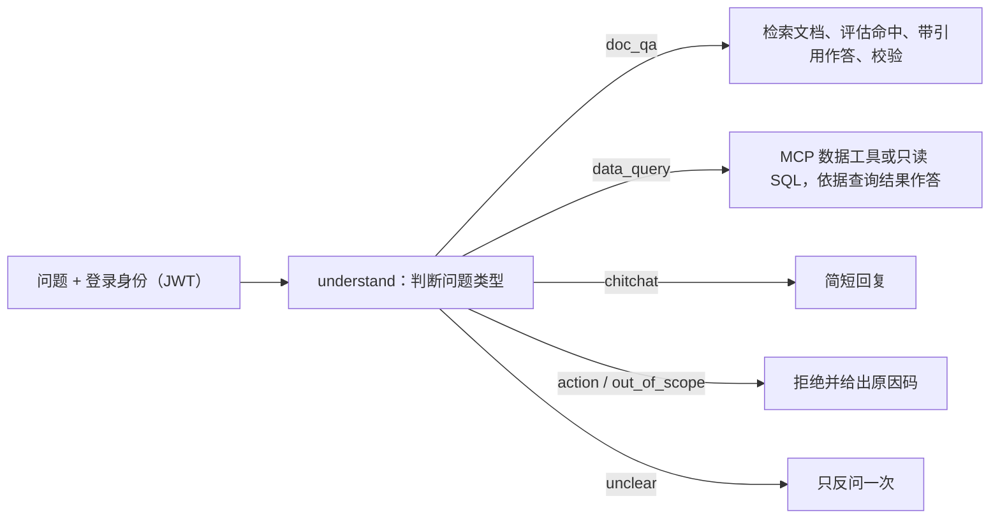

<p align="center">
  
</p>

# StarEdu

[English](README.chn.md) · **[试用：运行 AI 模块、业务模块，或两个一起](TRY-IT.chn.md)**

一个开源蓝本：给传统业务系统加上 AI。它把一个企业后台和一个 AI 知识助手、智能体放在一起，用同一家示例公司 **StarIT Education**（一家在全国有八个校区的 IT 培训公司）作为贯穿始终的例子。

| 模块 | 目录 | 状态 |
|---|---|---|
| AI 模块：RAG、智能体、接口、网页聊天 | [`ai-module/`](ai-module/) | 用 Docker Compose 在本机运行 |
| 业务模块：TypeScript 的多租户后台（参照一个开源竞品） | [`business-module/`](business-module/)（[概览](business-module/README.chn.md)、[试用](business-module/TRY-IT.chn.md)、[English](business-module/README.chn.md)） | 用 Docker Compose 在本机运行；自带演示公司、账号和一条命令重置 |

## AI 模块做什么

- **知识库。** 文档（md、txt、docx、pdf）经解析、切块、向量化后存入带 pgvector 的 PostgreSQL。
- **混合检索。** 关键词和向量检索用倒数排名融合合并，再用模型重排。基于角色的权限在数据库查询内、排序之前生效。
- **有权限意识的助手**，用 LangGraph 构建。只在必要时反问；拒绝越界和写操作请求；带引用作答；每个回答都对照来源校验。数据类问题（"有多少报销超过上限？"）走只读 SQL 视图和 MCP 服务，范围限定为提问者。
- **流式回答**，走服务端推送事件。没通过校验的草稿会被撤回并替换。
- **运维。** LiteLLM 网关带模型备用链（先 OpenAI，再 Anthropic）、按用户和按 IP 限速、每日费用预算、Keycloak 登录、只增不改的审计日志，以及可选的 OpenTelemetry / Grafana / Langfuse。
- **评测。** 114 道文档题、41 道数据题和一次权限泄露扫描，报告在 [`docs/eval/`](docs/eval/)。最近一次答案评测：107/114，20% 的人工抽查与模型判官在 23 项中一致 21 项。

## 一个问题怎么分流

没有单独的"路由 Agent"。助手是一张固定的 LangGraph 图，分流只是图里的一个步骤。有两个问题是各自独立回答的，容易混在一起：

| 问题 | 由什么决定 | 在哪里发生 |
|---|---|---|
| **这个问题走哪条路？** | **问题的类型** | `understand` 步骤：一次模型调用，判断意图 |
| **这个人能看到什么？** | **登录的账号** | 数据库查询和数据工具内部，不经过模型 |



- **问题类型决定走哪条路。** 同一个账号先问制度、再问数字，会走两个不同的分支。模型看不到提问者的身份，也不允许自己判断身份。
- **账号只决定"能看到什么"。** 身份来自签名的令牌，一次运行开始后只读。文档权限在检索 SQL 里、排序之前过滤；数据问答跑在按提问者过滤行的视图上，MCP 工具会把用户的令牌原样转发。
- **所以同一个问题，不同账号走同一条路，看到的结果不同。** 用 `qing.hr.bj`（HR）和 `wei.stu.sh`（学员）分别问 "What is the base salary band for a Senior Instructor at a Tier 1 campus?"：HR 得到薪资带并带引用，学员得到固定的"找不到"话术。文档不存在和无权限说的是同一句话，所以回答不会透露受限文档是否存在。

为什么是一张图，而不是多个 Agent：外层流程（检索、权限过滤、校验、收尾）是固定的代码，模型只用在几个明确的步骤里。这样每次运行可预期、可测试、评测成本低。数据路径里的 SQL 部分是有次数上限的小循环。Analytics Agent、Web Search Agent 在[第二阶段计划](docs/design/09-phase2-plan.chn.md)里是候选项，没有做。代码在 [`graph.py`](ai-module/packages/core/src/starit_core/agent/graph.py)（路由表）和 [`nodes.py`](ai-module/packages/core/src/starit_core/agent/nodes.py)（`understand`）。

## 快速开始

这里只讲 AI 模块；业务模块和两个一起跑见 [`TRY-IT.chn.md`](TRY-IT.chn.md)。

需要：Docker Compose（8 GB 以上内存）、[uv](https://docs.astral.sh/uv/)、`make` 和一个 OpenAI 密钥。

```bash
git clone https://github.com/Andy-Pan-8849/StarEdu.git
cd StarEdu/ai-module
make env            # 生成 .env，把 OPENAI_API_KEY 填进去
make sync && make up && make seed
```

打开 <http://localhost:3000>，用 `wei.stu.sh` 登录，密码 `demo-pass-123`（仅限本地的演示账号）。详情见 [`ai-module/README.chn.md`](ai-module/README.chn.md)。

## 架构

| 部分 | 技术 |
|---|---|
| 前端 | Next.js 15、Tailwind CSS |
| AI 后端 | FastAPI、LangGraph、MCP 服务 |
| 大模型 | 经 LiteLLM 使用 OpenAI 和 Anthropic |
| 数据库 / 队列 | PostgreSQL + pgvector、Redis |
| 身份 | Keycloak（OIDC） |
| 部署 | 目前是 Docker Compose；服务器档位计划用 k3s |

设计文档在 [`docs/design/`](docs/design/)；每个里程碑交付了什么见 [`docs/design/08-milestone-checklists.md`](docs/design/08-milestone-checklists.chn.md)。

## 仓库结构

```
StarEdu/
├── README.md              英文总览；README.chn.md 是本文件（中文）
├── TRY-IT.md              怎么运行和试用每个模块，或两个一起（TRY-IT.chn.md 是中文）
├── LICENSE                MIT
├── ai-module/             AI 模块：你要运行的全部内容（自己的 README、Makefile、各个服务和评测）
├── business-module/       多租户后台（NestJS + Next.js），有自己的 README 和试用指南
├── assets/logo/           品牌标志：logo.svg（完整）和 logo-mark.svg（小图标，不带文字）
└── docs/                  设计文档和评测报告
    ├── design/            编号的设计文档 01-09 和里程碑清单
    └── eval/              评测报告、人工抽查表和验收记录
```

AI 模块内部每个文件夹是做什么的，见 [`ai-module/README.chn.md`](ai-module/README.chn.md) 的"项目目录结构"一节。每个源文件开头都有一段注释，说明这个文件做什么、背后的想法。测试放在被测代码旁边（各包和各应用里的 `tests/` 文件夹）。

## 示例数据

[`ai-module/sample-data/`](ai-module/sample-data/) 里的一切都是合成的：公司、姓名、数字、制度和网址（`*.starit.example`）都是虚构的。包含 28 份文档和 7 张数据表，并刻意埋了一些检索难点，比如被取代的旧版制度、基于角色的访问、精确编号和无法回答的问题。

## 路线图

1. AI 模块：已完成到里程碑 M9。下一批见 [`docs/design/09-phase2-plan.md`](docs/design/09-phase2-plan.chn.md)。
2. 业务模块（NestJS 后台）：已完成到里程碑 B25，带演示数据和公开试用模式。
3. 部署档位（完整和精简）和公开演示站。
4. 示例数据的中文版。

## 许可证

MIT，见 [LICENSE](LICENSE)。
