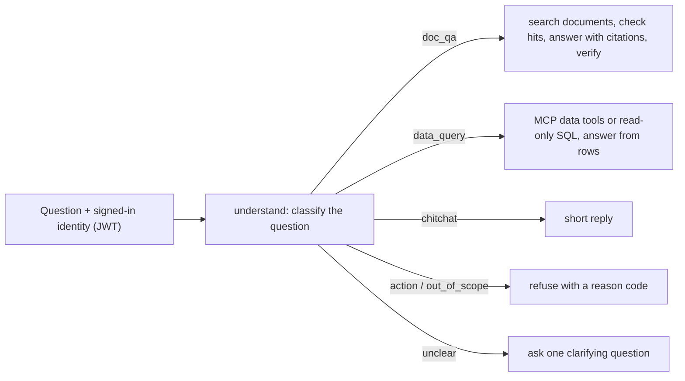

<p align="center">
  
</p>

# StarEdu

[中文](README.chn.md) · **[Try it: run the AI module, the business module, or both](TRY-IT.md)**

An open-source blueprint for adding AI to a traditional business system. It pairs an enterprise back office with an AI knowledge assistant and agents, using one sample company, **StarIT Education** (an IT training company with eight campuses all around the country), as the running example.

| Module | Folder | Status |
|---|---|---|
| AI module: RAG, agents, API, web chat | [`ai-module/`](ai-module/) | Runs locally with Docker Compose |
| Business module: multi-tenant back office in TypeScript (modeled on an open-source competitor) | [`business-module/`](business-module/) ([overview](business-module/README.md), [try it](business-module/TRY-IT.md), [中文](business-module/README.chn.md)) | Runs locally with Docker Compose; demo companies, accounts and one-command reset included |

## What the AI module does

- **Knowledge base.** Documents (md, txt, docx, pdf) are parsed, chunked, embedded and stored in PostgreSQL with pgvector.
- **Hybrid search.** Keyword and vector search fused with reciprocal rank fusion, then a model reranker. Role-based permissions are applied inside the database query, before ranking.
- **A permission-aware assistant** built with LangGraph. It asks a clarifying question only when needed, refuses out-of-scope or write requests, answers with citations, and verifies each answer against its sources. Data questions ("how many claims exceed the limit?") run through read-only SQL views and an MCP server, scoped to the asker.
- **Streaming answers** over Server-Sent Events. A draft that fails verification is withdrawn and replaced.
- **Operations.** A LiteLLM gateway with a model fallback chain (OpenAI, then Anthropic), per-user / per-IP rate limits, a daily cost budget, Keycloak login, an append-only audit log, and OpenTelemetry / Grafana / Langfuse (optional).
- **Evaluation.** 114 document questions, 41 data questions and a permission leak sweep, with reports in [`docs/eval/`](docs/eval/). Latest answer run: 107/114, and a human review of a 20% sample agreed with the model judge on 21 of 23 items.

## How a question is routed

There is no separate "router agent". The assistant is one fixed LangGraph graph, and routing is a single step inside it. Two questions are answered independently, and they are easy to mix up:

| Question | Decided by | Where it happens |
|---|---|---|
| **Which path does this question take?** | The **type of the question** | The `understand` step: one model call that classifies the intent |
| **What may this person see?** | The **signed-in account** | Inside the database query and the data tools, never in the model |



- **The question type chooses the path.** The same account asking about a policy and then about a number goes down two different branches. The model never sees the asker's identity, and it is not allowed to decide on one.
- **The account decides only what is visible.** Identity comes from the signed token and is read-only once a run starts. Document permissions are applied inside the search SQL before ranking; data questions run on views that filter rows by the asker, and the MCP tools forward the user's token.
- **So the same question from two accounts takes the same path and returns different results.** Ask "What is the base salary band for a Senior Instructor at a Tier 1 campus?" as `qing.hr.bj` (HR) and as `wei.stu.sh` (a student): HR gets the band with a citation, the student gets the fixed "could not find" reply. A missing document and a forbidden one read the same, so the answer does not reveal that a restricted document exists.

Why one graph rather than several agents: the outer flow (search, permission filter, verification, wrap-up) is fixed code, and the model is used only in a few named steps. That keeps runs predictable, testable and cheap to evaluate. The SQL part of the data path is a bounded sub-loop. Analytics and web-search agents are listed in the [phase 2 plan](docs/design/09-phase2-plan.md) as candidates and are not built. The code is in [`graph.py`](ai-module/packages/core/src/starit_core/agent/graph.py) (the routing table) and [`nodes.py`](ai-module/packages/core/src/starit_core/agent/nodes.py) (`understand`).

## Quick start

This is the AI module only; [`TRY-IT.md`](TRY-IT.md) covers the business module and running both together.

Requirements: Docker Compose (8 GB of memory or more), [uv](https://docs.astral.sh/uv/), `make`, and an OpenAI API key.

```bash
git clone https://github.com/Andy-Pan-8849/StarEdu.git
cd StarEdu/ai-module
make env            # creates .env; set OPENAI_API_KEY in it
make sync && make up && make seed
```

Open <http://localhost:3000> and sign in as `wei.stu.sh` with the password `demo-pass-123` (a local demo account). See [`ai-module/README.md`](ai-module/README.md) for the details (in Chinese).

## Architecture

| Part | Technology |
|---|---|
| Front end | Next.js 15, Tailwind CSS |
| AI back end | FastAPI, LangGraph, MCP server |
| LLMs | OpenAI and Anthropic through LiteLLM |
| Database / queue | PostgreSQL + pgvector, Redis |
| Identity | Keycloak (OIDC) |
| Deployment | Docker Compose today; k3s planned for the server profile |

Design documents are in [`docs/design/`](docs/design/); what each milestone delivered is in [`docs/design/08-milestone-checklists.md`](docs/design/08-milestone-checklists.md).

## Repository layout

```
StarEdu/
├── README.md              this file (English); README.chn.md is the Chinese version
├── TRY-IT.md              how to run and try each module, or both (TRY-IT.chn.md in Chinese)
├── LICENSE                MIT
├── ai-module/             the AI module: everything you run
│   ├── README.md          detailed guide, in Chinese: start, try, test, directory layout
│   ├── Makefile           the commands you use every day (make up, make seed, make eval ...)
│   ├── pyproject.toml     uv workspace root; shared ruff, mypy and pytest settings
│   ├── alembic.ini        database migration tool settings
│   ├── conftest.py        pytest fixtures shared by every test directory
│   ├── .env.example       environment variable template (copied to .env by `make env`)
│   ├── packages/core/     shared Python library, starit_core (see below)
│   ├── apps/              the three services, each a thin entry point over the core library
│   │   ├── api/           HTTP API (FastAPI): conversations, chat with SSE streaming, documents
│   │   ├── worker/        ingestion worker: takes documents from the queue and indexes them
│   │   └── mcp-server/    MCP server that exposes the data tools, with its own token check
│   ├── web/               front end (Next.js): chat, citation drawer, document management
│   ├── eval/              evaluation tool `starit-eval`: retrieval, answers, data questions, leaks
│   ├── migrations/        Alembic database migrations (roles, tables, row-level SQL views)
│   ├── scripts/           helper scripts: seeding, sample ingestion, Keycloak realm builder, tokens
│   ├── seed/              ready-made knowledge base dump, so `make seed` needs no model key
│   ├── deploy/            Docker Compose files, Dockerfiles, LiteLLM, Grafana/Tempo/Prometheus config
│   └── sample-data/       synthetic company: documents, tables, demo accounts, evaluation questions
├── assets/logo/           brand logo: logo.svg (full) and logo-mark.svg (small, no lettering)
├── business-module/       the multi-tenant back office (NestJS + Next.js), with its own README and trial guide
└── docs/                  design documents and evaluation reports
    ├── design/            numbered design documents 01-09 and the milestone checklists
    └── eval/              evaluation reports, human review sheets and acceptance notes
```

### Inside the core library (`ai-module/packages/core/src/starit_core/`)

| Folder / file | What it does |
|---|---|
| `agent/` | The assistant as a LangGraph flow: `nodes.py` (every step), `graph.py` (wiring), `runtime.py` (one run, recorded), `state.py`, `events.py` (streaming events), `messages.py` (fixed replies), `prompts/` (prompt files, versioned in `prompts.py`) |
| `retrieval/` | Hybrid search: `keyword.py`, `vector.py`, `fusion.py` (rank fusion), `rerank.py`, `assemble.py`, `probe.py` (counts what the asker may not read), `search.py` (entry point) |
| `ingest/` | Document ingestion: `parsers/` (docx, pdf, md, txt), `clean.py`, `chunker.py`, `derive.py`, `pipeline.py`, `queue.py` (Postgres job queue), `worker.py`, `register.py` |
| `dataaccess/` | Business-data access: `tools.py` (six fixed tools), `sqlguard.py` (validates model-written SQL), `schema.py` (views and who may read them), `client.py` (MCP client) |
| `permissions.py`, `auth.py` | Who may read which chunks, enforced in the database query; JWT verification and the caller's identity |
| `llm.py`, `embeddings.py`, `streaming.py` | Model clients (gateway, fallback chain), embeddings, and the incremental extraction of the answer text from streamed JSON |
| `cost.py`, `ratelimit.py` | Cost of a call and the shared daily budget; fixed-window rate limiter |
| `documents.py`, `conversations.py`, `audit.py` | Reading and writing documents, conversations and the append-only audit log |
| `config.py`, `db.py`, `storage.py`, `sqlaccess.py` | Settings, database engine, object storage, running a read-only query as a given person |
| `telemetry.py`, `logging.py` | OpenTelemetry traces and metrics, JSON logs |
| `seed_ai.py`, `seed_biz.py`, `testing.py` | Knowledge-base dump and restore, sample business tables, test doubles shared by the tests |

Every source file starts with a header comment that says what the file is for and the idea behind it. Tests sit next to the code they test (`tests/` folders inside each package and app).

## Sample data

Everything in [`ai-module/sample-data/`](ai-module/sample-data/) is synthetic: the company, names, numbers, policies and URLs (`*.starit.example`) are invented. It includes 28 documents and 7 data tables, with deliberate retrieval challenges such as superseded policy versions, role-based access, exact identifiers and unanswerable questions.

## Roadmap

1. AI module: done through milestone M9. Next batch: see [`docs/design/09-phase2-plan.md`](docs/design/09-phase2-plan.md).
2. Business module (NestJS back office): done through milestone B25, with demo data and a hosted-trial mode.
3. Deployment profiles (full and lite) and a public demo.
4. A Chinese version of the sample data.

## License

MIT, see [LICENSE](LICENSE).
