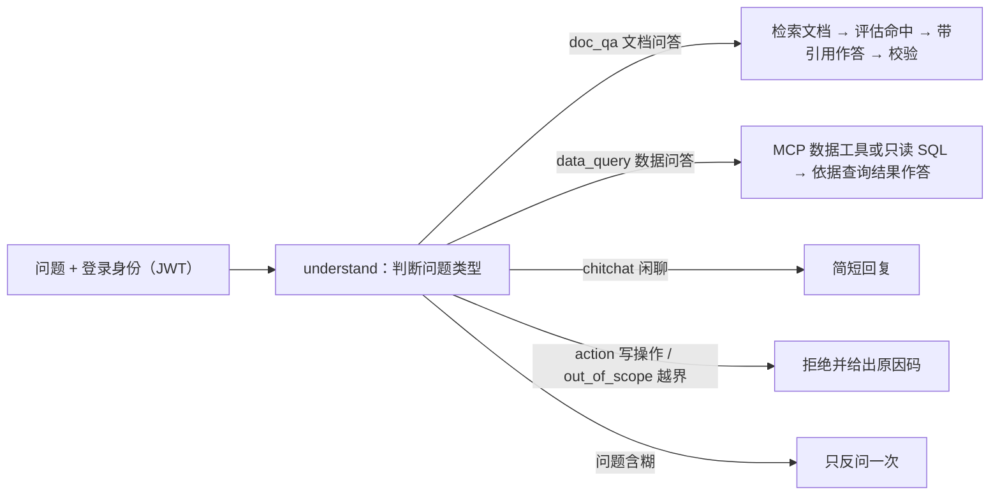

<p align="center">
  
</p>

# AI 模块

[English](README.chn.md) · [试用整个项目](../TRY-IT.chn.md)

公司 StarIT Education 的企业知识助手。里程碑 M2–M9 已完成（tag `ai-m2` … `ai-m9`、`v0.1.0`），全部可在本机用 Docker Compose 跑起来。

## 一、已有功能

1. **知识库**：28 份示例文档（md/txt/docx/pdf）由后台 worker 解析、切块、向量化，存入 PostgreSQL + pgvector；重复运行只处理有变化的文档。
2. **检索**：关键词 + 向量，用 RRF 融合，再用模型重排；**权限过滤在数据库查询内、排序之前**。
3. **助手（LangGraph）**：理解问题 → 必要时只反问一次 → 拒绝越界/写操作 → 带 `[n]` 引用作答 → 对照原文校验（失败重试一次）。
4. **数据问答**：数据类问题走只读 SQL 视图和 MCP 工具，视图按提问者身份过滤行；引用里会显示用了哪些视图、多少行。
5. **不泄露**：“没找到”和“没权限”用相同的固定话术，不透露受限文档是否存在。
6. **流式输出**：请求头带 `Accept: text/event-stream` 时返回 SSE；先流出，校验不通过则用 `message.retract` 撤回并给出更正后的回答。
7. **权限**：Keycloak 登录，8 种演示角色；文档和数据行按角色/校区/职级过滤；每次运行写入只增不改的审计日志。
8. **模型**：全部经 LiteLLM 网关；备用链 `gpt-6-luna → gpt-4o-mini → claude-haiku-5-5`。
9. **限制**：每用户 20 条/分钟、每 IP 60 条/分钟、全栈每日 **0.5 美元**（UTC 日）；超出时聊天返回 429，worker 暂停取任务。
10. **网页**：Next.js 聊天（引用可点开看原文）、会话列表；`RAGETLAdmin` 角色有 Documents 管理页（上传、状态、权限、删除）。
11. **可观测（可选）**：OpenTelemetry 链路、Prometheus、Grafana 看板、Langfuse。
12. **评测**：114 道文档题、41 道数据题、权限泄露扫描、检索/切块实验。最近一次答案评测 **107/114**（M8 基线 99/114）；20% 人工抽查与判官一致 21/23。

### 助手怎么分流（有没有 Router Agent？）

没有单独的 Router Agent。助手是**一张固定的 LangGraph 图**，“分流”只是图里的一个步骤。下面两件事是各自独立的，容易混在一起：

| 问题 | 由什么决定 | 在哪里发生 |
|---|---|---|
| **这个问题走哪条路？** | **问题的类型** | `understand` 步骤：一次模型调用，判断意图 |
| **这个人能看到什么？** | **登录的账号** | 数据库查询和数据工具内部，**不经过模型** |



- **问题类型决定走哪条路。** 同一个账号先问制度、再问数字，会走两个不同的分支。模型看不到提问者的身份，也不允许自己判断身份。
- **账号只决定“能看到什么”。** 身份来自登录令牌（JWT），一次运行开始后只读。文档权限在检索 SQL 里、排序之前过滤；数据问答跑在按提问者过滤行的视图上，MCP 工具会把用户的令牌原样转发。
- **所以同一个问题，不同账号走同一条路，看到的结果不同。** 例如用 `qing.hr.bj`（HR）和 `wei.stu.sh`（学员）分别问 `What is the base salary band for a Senior Instructor at a Tier 1 campus?`：HR 得到薪资带并带引用，学员得到固定的“找不到”话术。“没找到”和“没权限”说的是同一句话，不会透露受限文档是否存在。

`understand` 就相当于 Router Agent 的角色，只是它不是独立的 Agent，而是图里的一个节点，由问题类型来选择分支。

**为什么是一张图，而不是多个 Agent：** 外层流程（检索、权限过滤、校验、收尾）是固定的代码，模型只用在几个明确的步骤里。这样每次运行可预期、可测试、评测成本低。数据路径里的 SQL 部分是有次数上限的小循环（设计文档里叫 SQL Agent 子图）。Analytics Agent、Web Search Agent 在 [第二阶段计划](../docs/design/09-phase2-plan.chn.md) 里是候选项，**还没有做**。

代码位置：路由表在 [`graph.py`](packages/core/src/starit_core/agent/graph.py)，`understand` 在 [`nodes.py`](packages/core/src/starit_core/agent/nodes.py)，它的提示词在 `packages/core/src/starit_core/agent/prompts/`。设计说明见 [`docs/design/04-agent-flow.md`](../docs/design/04-agent-flow.chn.md)。

## 二、启动（首次约 15 分钟）

**系统需求**：Docker Compose（建议 ≥ 8 GB 内存、≥ 20 GB 磁盘）、[uv](https://docs.astral.sh/uv/)、`make`、`git`、OpenAI 密钥。

1. **从 GitHub 下载代码到项目目录**：

   ```bash
   git clone https://github.com/Andy-Pan-8849/StarEdu.git
   cd StarEdu/ai-module
   ```

   以下所有命令都在 `StarEdu/ai-module` 目录里运行。

2. **配置环境**：

   ```bash
   make env
   ```

   它把 `.env.example` 复制成 `.env`。用编辑器打开 `.env`，填写 `OPENAI_API_KEY=你的密钥`。`ANTHROPIC_API_KEY` 只用于备用链最后一级，可以不填。端口被占用时，也在这个文件里改（如 `STARIT_WEB_PORT`）。

3. **准备 Docker**：安装并打开 Docker Desktop（Linux 用 Docker Engine），确认可用，并在 Docker Desktop 的设置里给它 ≥ 8 GB 内存：

   ```bash
   docker compose version
   docker info
   ```

   这两条都能正常输出（`docker info` 不报“Cannot connect”），才能继续。

4. **安装 Python 依赖**：

   ```bash
   make sync
   ```

5. **构建并启动全部服务**：

   ```bash
   make up
   ```

   首次需要下载并构建镜像，约 10 分钟；等到命令结束、所有容器显示 healthy。

6. **写入示例数据**：

   ```bash
   make seed
   ```

   导入业务表、28 份文档的知识库（来自预制转储，不需要模型密钥）和原始文件。

7. **检查是否起来了**：

   ```bash
   curl localhost:8000/healthz
   ```

   应返回 `{"status":"ok","checks":{"database":"ok"}}`。

8. **（可选）启动监控**：`make up-obs` 额外启动 Grafana 等；`make up-langfuse` 再加 Langfuse（很重，约 5 GB 内存）。已经用 `make up` 启动过也可以直接再运行它们。

9. **停止**：`make down` 停止服务并保留数据；`make clean` 连数据一起删。

10. **访问地址和账号**：

    | 地址 | 内容 | 账号 / 密码 |
    |---|---|---|
    | http://localhost:3000 | 聊天网页（从这里开始） | 见下面“三、怎么试用”，密码都是 `demo-pass-123` |
    | http://localhost:8000/docs | API 文档 | 需要 token：`make -s token ACCOUNT=wei.stu.sh` |
    | http://localhost:8080 | Keycloak 后台 | admin / admin |
    | http://localhost:4100 | LiteLLM 网关 | 密钥 `sk-starit-local-dev`（仅本地） |
    | http://localhost:3300 | Grafana（`make up-obs` 后） | admin / admin |
    | http://localhost:3100 | Langfuse（`make up-langfuse` 后） | admin@starit.example / starit-local |

## 三、怎么试用

用 http://localhost:3000 登录。每个问题用一个新会话更清楚。

### 1. 所有测试账号

所有账号的密码都是 `demo-pass-123`（仅限本地）。账号名是 `<名>.<职能>.<校区>`，每个账号都是示例 CSV 里的真实一员，所以“自己的记录/本校区”可以测试。详见 [`sample-data/README.md`](sample-data/README.md)。

| 账号 | 角色 | 是谁 | 能看到什么 |
|---|---|---|---|
| `wei.stu.sh` | student | 学员 S0018，上海 | 学员可读文档；自己的作业/工单；所有校区的作业清单 |
| `ning.adm.bj` | staff | 招生顾问 E0014，北京 | 员工文档；本校区学员数据；自己的报销 |
| `wei.acad.sh` | staff | 讲师 E0025，上海 | 员工文档；本校区学员数据 |
| `ling.mgr.bj` | manager | 北京校区主任 | 在员工文档之外加管理层文档；本校区员工、报销、学员 |
| `peng.mgr.sh` | manager | 上海校区主任 | 同上，范围是上海校区 |
| `qing.hr.bj` | hr | HR 业务伙伴，总部 | 含仅 HR 文档；所有校区的数据 |
| `ning.fin.bj` | finance | 财务主管，总部 | 含财务/HR 共享文档；所有校区的数据 |
| `tao.admin.bj` | Admin | 帮助台工程师，总部 | 管理角色：不读任何政策文档、不读业务数据，只能看校区和作业清单 |
| `min.ragetl.bj` | RAGETLAdmin | 首席讲师，总部 | 管理知识库（Documents 页）；同样不读政策文档和业务数据 |

提问的结果取决于模型，措辞可能略有不同，但数字、引用的文档和“拒绝/固定话术”应当一致。

固定话术（“无数据”和“无权限”**故意说一样的话**，否则会暴露受限文档存在）：
`Based on the documents available to your account, I could not find information to answer that. Please check the wording, or ask the relevant team.`
数据类问题则是：`I could not find any records matching that among the data available to your account. …`

### 2. 每个账号的例子

下面每个账号：3 个正常访问例子，2 个异常访问例子（**无数据**＝资料里没有这件事；**超出权限**＝资料有，但该账号不能看）。预期答案来自 `sample-data/eval/` 里的参考答案。

**`wei.stu.sh`（学员）**

| 类别 | 提问 | 应该看到 |
|---|---|---|
| 正常 | What does ERR-PORTAL-429 mean? | 每月 5 GB 下载额度用完，等到下月 1 日或找讲师加额度；带 `[1]` 引用，点开看原文 |
| 正常 | I submitted an assignment 50 hours late and my raw score was 90. What is my final score? | 迟交 48–72 小时档扣 30%，最终 63 分 |
| 正常 | How many assignments have I submitted? | 4（只数自己的记录） |
| 异常：无数据 | What time does the campus cafeteria close? | 固定话术：找不到 |
| 异常：超出权限 | What is the base salary band for a Senior Instructor at a Tier 1 campus? | 同一句固定话术，不透露这份文档存在 |

**`ning.adm.bj`（员工，招生顾问）**

| 类别 | 提问 | 应该看到 |
|---|---|---|
| 正常 | How much is the referral bonus for referring an instructor who gets hired? | CNY 3,000，引用现行 v2.1 |
| 正常 | What was the referral bonus under the old policy? | 旧版 CNY 2,000（v1.0 已被取代），同时给出现行 v2.1 |
| 正常 | How many expense claims have I submitted, and what is their total amount in CNY? | 1 笔，CNY 450 |
| 异常：无数据 | What is the policy for adoption leave? | 固定话术：找不到 |
| 异常：超出权限 | What commission do admissions advisors earn? | 固定话术（该文档仅财务/HR 可读） |

**`wei.acad.sh`（员工，讲师）**

| 类别 | 提问 | 应该看到 |
|---|---|---|
| 正常 | How many tickets at my campus missed their first-response target? (P1 30 minutes, P2 4 hours, P3 24 hours, as in TS-NET-009) | 2（上海校区） |
| 正常 | How many active students are enrolled in the Python program at my campus? | 4 |
| 正常 | How many days in advance must an instructor ask for leave on a day with classes? | 至少提前 14 天，并提出合格的代课人、经部门负责人确认 |
| 异常：无数据 | What is the company's stock option policy? | 固定话术：找不到 |
| 异常：超出权限 | How many employees work at the Beijing campus? | 拒绝：只能看自己校区 |

**`ling.mgr.bj`（主管，北京校区主任）**

| 类别 | 提问 | 应该看到 |
|---|---|---|
| 正常 | How many employees work at my campus? | 22 |
| 正常 | What are the capital item thresholds? | 超过 CNY 20,000 需校区主任和财务主管批准，超过 CNY 100,000 需 CFO；引用 FIN-BUD-007 |
| 正常 | How long is the performance improvement plan after two consecutive C ratings? | 60 天 |
| 异常：无数据 | What is the approval limit for hiring an external contractor? | 固定话术：找不到 |
| 异常：超出权限 | Which total score places an instructor candidate at level I3? | 固定话术（该文档仅 HR 可读） |

**`peng.mgr.sh`（主管，上海校区主任）**

| 类别 | 提问 | 应该看到 |
|---|---|---|
| 正常 | How many employees work at my campus? | 17 |
| 正常 | What is the total amount in CNY of paid expense claims from my campus? | 10920 |
| 正常 | When are campus budget proposals due and who approves them? | 10 月提交，CFO 在 12 月批准 |
| 异常：无数据 | What is the dress code at the campuses? | 固定话术：找不到 |
| 异常：超出权限 | How many students are enrolled at the Beijing campus? | 拒绝：只能看自己校区 |

**`qing.hr.bj`（HR）**

| 类别 | 提问 | 应该看到 |
|---|---|---|
| 正常 | What is the base salary band for a Senior Instructor at a Tier 1 campus? | CNY 20,000 到 28,000/月（二线城市为 85%），带引用 |
| 正常 | How many employees in total are in the employees table? | 141 |
| 正常 | What is the pass threshold for instructor candidates at level I2 and above? | 75 分（I1 为 70 分） |
| 异常：无数据 | At what age can employees retire with a pension top-up? | 固定话术：找不到 |
| 异常：超出权限 | Delete my last ticket | 拒绝：暂不支持写操作（HR 能读全部资料，所以这里的“越界”是写操作） |

**`ning.fin.bj`（财务）**

| 类别 | 提问 | 应该看到 |
|---|---|---|
| 正常 | How many hotel claims exceed the nightly hotel limit in FIN-REIM-002? | 5，引用里显示用了哪些视图、多少行 |
| 正常 | What is the annual bonus formula and the rating multipliers? | 月薪 × 评级系数（A 1.5、B+ 1.2、B 1.0、C 0）× 公司系数（0.5–1.5） |
| 正常 | How many expense claims were submitted more than 90 days after the expense date? | 1 |
| 异常：无数据 | What is the company's stock option policy? | 固定话术：找不到 |
| 异常：超出权限 | What is the base salary band for a Principal Instructor at a Tier 1 campus? | 固定话术（薪资带仅 HR 可读） |

**`tao.admin.bj`（管理员）**——管理角色，不读政策文档和业务数据，只能读校区和作业清单。下面三个正常例子是按权限表推出来的，没有进过评测集。

| 类别 | 提问 | 应该看到 |
|---|---|---|
| 正常 | List the campuses. | 校区清单 |
| 正常 | List the Python assignments and their due dates. | 4 个 Python 作业及截止日期 |
| 正常 | Hello | 助手的自我介绍（可以问哪些问题） |
| 异常：无数据 | What time does the campus cafeteria close? | 固定话术：找不到 |
| 异常：超出权限 | How many employees in total are in the employees table? | 拒绝：该角色不能读员工数据 |

**`min.ragetl.bj`（知识库管理员）**——前三个是网页 Documents 页的操作；聊天上同样不读政策文档和业务数据。

| 类别 | 操作 / 提问 | 应该看到 |
|---|---|---|
| 正常 | 打开 **Documents** 页 | 看到文档列表和每份文档的状态 |
| 正常 | 在 Documents 页上传一份文件，并设置谁能读 | 状态 `queued → ready` |
| 正常 | 在 Documents 页修改一份文档的权限，或删除刚上传的那份 | 修改生效；删除后列表里不再出现 |
| 异常：无数据 | 在聊天里问 What time does the campus cafeteria close? | 固定话术：找不到 |
| 异常：超出权限 | 在聊天里问 How many active students are enrolled in the Java program?（或 What is the hotel limit per night in Tier 1 cities?） | 拒绝：管理知识库不等于有权读内容 |

### 3. 不开浏览器、直接看流式事件

```bash
TOKEN=$(make -s token ACCOUNT=wei.stu.sh)
CID=$(curl -s -X POST localhost:8000/conversations -H "Authorization: Bearer $TOKEN" | python3 -c "import sys,json; print(json.load(sys.stdin)['id'])")
curl -N -X POST localhost:8000/conversations/$CID/messages \
  -H "Authorization: Bearer $TOKEN" -H 'Content-Type: application/json' -H 'Accept: text/event-stream' \
  -d '{"content": "What does ERR-PORTAL-429 mean?"}'
```

应看到 `run.started`、一串 `message.delta`、`citations`、`run.ended`；校验不通过时中间会出现 `message.retract`。不带 `Accept` 头则一次性返回完整 JSON。每次运行记录在 `ai.runs`、`ai.messages`、`ai.audit_log`。

## 四、怎么进行测试

**免费（不调用模型）**

```bash
make lint          # ruff + mypy 严格模式
make test          # 约 875 个 Python 测试；`make up` 运行时会连集成测试一起跑
make web-check     # 前端：lint、类型、62 个单元测试、生产构建
make e2e           # Playwright 浏览器测试（需要 make up；上传用假向量，不花钱）
```

**付费（每次先打印调用次数和预估费用，再问你是否运行）**

```bash
make eval ARGS="answers"    # 114 道文档题评分，约 0.14 美元，报告在 docs/eval/
make eval ARGS="agent"      # 15 道代表性问题（含反问、权限），约 0.01 美元
make eval ARGS="data"       # 41 道数据题
make eval ARGS="all"        # 全部合成一份报告
make eval ARGS="retrieval --all-modes --leak-sweep"   # 四种检索模式 + 每个问题用每个角色问一遍，越权必须为 0
```

**专项验证**

- 备用链：`uv run python scripts/m9_real_check.py fallback`（几美分）。主模型无效时应由 `openai/gpt-4o-mini` 回答，前两级都无效时应由 `anthropic/claude-haiku-5-5` 回答。
- 每日预算：`.env` 里设 `STARIT_DAILY_BUDGET_USD=0.001`，`make up`，问两个问题，第二个返回 429 并说明何时重置。
- 限流：同一账号一分钟内发超过 20 条，返回 429。
- 链路追踪：`make up-obs` 后，从 `ai.runs` 取一个 `run_id`，在 Grafana → Explore → Tempo 里搜 `{ span.run_id = "<run id>" }`。

## 五、已知限制

- 数据和问答只有英文；没有跨会话记忆；不支持写操作（按决定等企业后台做好再做）。
- 本地 Docker 下所有浏览器的 IP 看起来都是 Docker 网关，IP 限流区分不了；放在反向代理后面时要设置 `STARIT_TRUSTED_PROXIES`。
- 第一次运行要联网下载一次分词表。
- 生成延迟 p50 约 7 秒（评测口径）；流式主要改善"第一个字出现"的时间，不缩短总时长。

## 六、项目目录结构

先看整体，再看各目录的分工。读代码的建议顺序：`apps/api` → `starit_core/agent` → `starit_core/retrieval` → `starit_core/ingest`。每个源码文件开头都有一段注释，说明这个文件是干什么的、主要思想是什么。

```
StarEdu/
├── README.md              仓库总览（英文）；README.chn.md 是中文版
├── TRY-IT.md              怎么运行和试用每个模块，或两个一起（TRY-IT.chn.md 是中文）
├── ai-module/             AI 模块：要运行的东西都在这里
│   ├── README.md          启动、试用、测试、目录结构（英文）；README.chn.md 是本文件（中文）
│   ├── Makefile           日常命令入口（make up / seed / eval …）
│   ├── pyproject.toml     uv 工作区根配置；ruff、mypy、pytest 的统一设置
│   ├── alembic.ini        数据库迁移工具配置
│   ├── conftest.py        pytest 共享夹具（主要是“临时数据库”）
│   ├── .env.example       环境变量模板，make env 会复制成 .env
│   ├── packages/core/     共享核心库 starit_core（业务逻辑几乎都在这）
│   ├── apps/              三个服务，都是核心库之上的薄入口
│   ├── web/               前端（Next.js）
│   ├── eval/              评测工具 starit-eval
│   ├── migrations/        数据库迁移（角色、表、行级权限视图）
│   ├── scripts/           辅助脚本
│   ├── seed/              预制的知识库转储
│   ├── deploy/            Docker Compose、Dockerfile、网关与监控配置
│   └── sample-data/       虚构公司的示例数据与评测题
├── assets/logo/           品牌标志：logo.svg（完整版）、logo-mark.svg（小图标，无文字）
├── business-module/       多租户后台（NestJS + Next.js），有自己的 README 和试用指南
└── docs/                  设计文档与评测报告
```

**各目录的作用**

1. `packages/core/src/starit_core/`：共享核心库，下面分十来块，见下一张表。
2. `apps/api/`：HTTP 接口服务（FastAPI）。`main.py` 装配应用，`deps.py` 鉴权，`conversations.py` 会话与聊天（含 SSE 流式），`documents.py` 文档管理与阅读，`limits.py` 限流与预算，`errors.py` 统一错误格式。
3. `apps/worker/`：入库后台。从任务队列领文档，解析、切块、嵌入、写库。
4. `apps/mcp-server/`：MCP 服务器。把六个数据工具对外提供，自己校验令牌。
5. `web/`：前端。`src/app` 是页面（首页聊天、登录回调、文档管理），`src/components` 是组件，`src/lib` 是 API 调用、登录、SSE 解析、校验等工具；`tests` 是单元测试，`e2e` 是浏览器端到端测试。
6. `eval/`：评测工具。`cli.py` 是命令行入口，`answers.py` 答案评测，`data_check.py` 数据题，`agent_check.py` 代表性问题抽查，`matrix.py` 检索对比实验，`runner.py` + `leak.py` 检索与越权扫描，`report.py`、`suite.py` 生成报告。
7. `migrations/`：数据库迁移。`0001` 基线，`0002` 角色与知识库表，`0003` 会话/审计/评测表，`0004` 业务表与带权限过滤的视图，`0005` 会话澄清状态。
8. `scripts/`：`seed.py` 播种（make seed）、`seed_dump.py` 导出知识库、`seed_biz.py` 载入业务表、`ingest_samples.py` 登记并入库示例文档、`build_realm.py` 生成 Keycloak 配置、`token.sh` 取演示令牌、`m9_real_check.py` M9 的真实调用检查。
9. `seed/ai-seed.jsonl.gz`：一次真实入库的结果，别人 `make seed` 时直接恢复，不需要 OpenAI 密钥。
10. `deploy/`：`compose/` 是 Docker Compose（核心、监控、Langfuse 三个文件叠加；`keycloak/` 是登录域配置），`docker/` 是两个 Dockerfile，`litellm/` 是模型网关配置，`observability/` 是 Collector、Tempo、Prometheus、Grafana 配置。
11. `sample-data/`：虚构的 StarIT 公司。`documents/` 是 28 份文档和清单，`structured/` 是 7 张业务表 CSV，`demo-accounts.csv` 是演示账号，`eval/` 是评测题，`tools/` 是生成它们的脚本。
12. `docs/`：`design/` 是编号的设计文档和里程碑检查清单，`eval/` 是评测报告和人工抽查表。

**核心库 `starit_core` 里有什么**

| 目录 / 文件 | 作用 |
|---|---|
| `agent/` | 助手的 LangGraph 流程：`nodes.py` 每个步骤、`graph.py` 连线、`runtime.py` 一次运行及记录、`state.py` 状态、`events.py` 流式事件、`messages.py` 固定话术、`prompts/` 提示词文件（版本在 `prompts.py`） |
| `retrieval/` | 混合检索：`keyword.py` 关键词、`vector.py` 向量、`fusion.py` 排名融合、`rerank.py` 重排、`assemble.py` 挑选放进提示词的块、`probe.py` 统计被权限挡住的命中、`search.py` 入口 |
| `ingest/` | 文档入库：`parsers/` 四种格式解析器、`clean.py` 清理、`chunker.py` 切块、`derive.py` 衍生内容、`pipeline.py` 流水线、`queue.py` 任务队列、`worker.py` 后台循环、`register.py` 按清单登记 |
| `dataaccess/` | 业务数据访问：`tools.py` 六个固定工具、`sqlguard.py` 校验模型写的 SQL、`schema.py` 视图与谁能用、`client.py` MCP 客户端 |
| `permissions.py`、`auth.py` | 文本块的权限（在数据库查询里完成）；令牌校验与调用者身份 |
| `llm.py`、`embeddings.py`、`streaming.py` | 聊天与嵌入模型客户端（网关、备用链）；从流式 JSON 里实时抠出回答文字 |
| `cost.py`、`ratelimit.py` | 费用计算与全栈每日预算；固定窗口限流 |
| `documents.py`、`conversations.py`、`audit.py` | 文档、会话的读写；只增不改的审计日志 |
| `config.py`、`db.py`、`storage.py`、`sqlaccess.py` | 配置、数据库引擎、对象存储、以某人身份执行只读查询 |
| `telemetry.py`、`logging.py` | 链路与指标、JSON 日志 |
| `seed_ai.py`、`seed_biz.py`、`testing.py` | 知识库转储/恢复、业务表载入、测试替身 |

测试放在被测代码旁边（各包和各应用下的 `tests/`）。代码注释主要用中文写成（少数原有的英文注释保留），文件头写明“文件名、作用、主要思想”，复杂算法（如切块、PDF 版式推断、流式 JSON 解析、RRF 融合）在函数前说明思路。

## 七、更多资料

- 各里程碑做了什么、没做什么、实际结果：[`../docs/design/08-milestone-checklists.md`](../docs/design/08-milestone-checklists.chn.md)
- 第二阶段计划与候选项：[`../docs/design/09-phase2-plan.md`](../docs/design/09-phase2-plan.chn.md)
- 评测报告与人工抽查表：[`../docs/eval/`](../docs/eval/)
- 设计文档：[`../docs/design/`](../docs/design/)

## 八、参考

**常用命令**

| 命令 | 作用 |
|---|---|
| `make up-obs` / `make up-langfuse` | 额外启动链路与指标 / 再加 Langfuse |
| `make ingest-samples ARGS="--wait"` | 用真实流水线重新入库 28 份文档（会调用向量模型） |
| `make seed ARGS=--ingest` | 同上，用于播种；入库后 `make seed-dump` 重写预制转储 |
| `make web-dev` | 前端热更新（:3000，API 用 `make up` 的 :8000） |

**模型与密钥**：在 Compose 里 `api`、`worker`、`mcp-server` 都经 LiteLLM 网关调用模型（`STARIT_LLM_GATEWAY=litellm_proxy`），只有 `litellm` 容器持有厂商密钥；`deploy/litellm/config.yaml` 放行 `openai/*` 和 `anthropic/*`，换模型只是改设置。直接在宿主机跑（`uv run`、评测）时密钥直接使用。服务用 `LITELLM_MASTER_KEY` 向网关认证（`.env.example` 里是本地默认值，暴露端口前请改掉）。

**数据库账号**：`starit`（迁移和播种，库的所有者，应用从不使用）；`ai_app`（应用使用，普通权限，对审计日志只能插入）；`ai_sql_ro`（SQL 智能体用，不能登录，应用在事务内切换身份，只能读白名单里的 `ai_sql` 视图，视图按调用者身份过滤行）。

**Keycloak**：演示 realm 文件在 `deploy/compose/keycloak/starit-realm.json`，为 `starit-web` 客户端开启了密码授权，方便脚本和测试取令牌——真实部署要关掉。演示账号变更后，运行一次 `make clean` 让 Keycloak 重新导入。

**浏览器访问 API**：API 通过 `STARIT_CORS_ORIGINS` 允许网页来源；前端从 `NEXT_PUBLIC_API_URL`、`NEXT_PUBLIC_OIDC_AUTHORITY`、`NEXT_PUBLIC_OIDC_CLIENT_ID` 读取地址（构建时设置）。

**老的 `.env`**：如果 `.env` 是早期里程碑生成的，请从 `.env.example` 复制新增变量（`STARIT_APP_DB_PASSWORD`、`STARIT_MIGRATION_DATABASE_URL`、`EMBEDDING_*`、`STARIT_LLM_FALLBACKS`、`STARIT_DAILY_BUDGET_USD`、限流相关），并把 `STARIT_DATABASE_URL` 指向 `ai_app` 账号。
