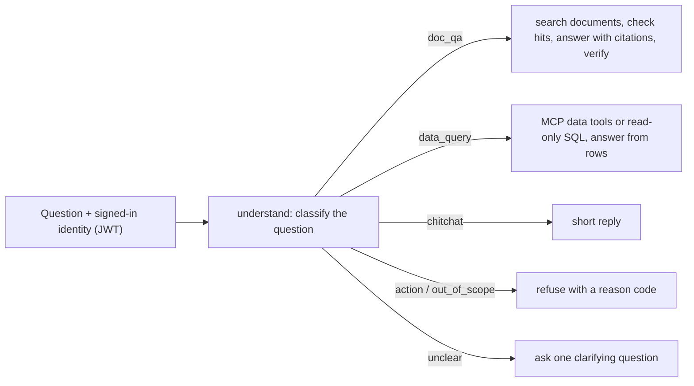

<p align="center">
  
</p>

# AI module

[中文](README.chn.md) · [Try the whole project](../TRY-IT.md)

The enterprise knowledge assistant of the company StarIT Education. Milestones M2 to M9 are done (tags `ai-m2` ... `ai-m9`, `v0.1.0`), and everything runs on your own machine with Docker Compose.

## 1. What it does

1. **Knowledge base.** 28 sample documents (md, txt, docx, pdf) are parsed, chunked and embedded by a background worker and stored in PostgreSQL with pgvector. Running it again only processes documents that changed.
2. **Search.** Keyword and vector search, fused with reciprocal rank fusion (RRF), then reranked by a model. **Permission filtering happens inside the database query, before ranking.**
3. **The assistant (LangGraph).** Understand the question, ask one clarifying question only if needed, refuse out-of-scope and write requests, answer with `[n]` citations, check the answer against the sources (retry once if it fails).
4. **Data questions.** Questions about numbers go through read-only SQL views and MCP tools. The views filter rows by who is asking, and the citation shows which views and how many rows were used.
5. **No leaks.** "Not found" and "not allowed" get the same fixed reply, so the answer never reveals whether a restricted document exists.
6. **Streaming.** With `Accept: text/event-stream` the API returns Server-Sent Events. The answer streams first; if verification fails, `message.retract` withdraws it and a corrected answer follows.
7. **Permissions.** Keycloak sign-in, eight demo roles; documents and data rows are filtered by role, campus and level; every run writes to an append-only audit log.
8. **Models.** Every call goes through the LiteLLM gateway; fallback chain `gpt-6-luna → gpt-4o-mini → claude-haiku-5-5`.
9. **Limits.** 20 messages per minute per user, 60 per minute per IP, and **US$0.50 per day** for the whole stack (UTC day). Over a limit, chat returns 429 and the worker pauses taking jobs.
10. **Web.** A Next.js chat page (click a citation to read the source) and a conversation list; the `RAGETLAdmin` role has a Documents page (upload, status, permissions, delete).
11. **Observability (optional).** OpenTelemetry traces, Prometheus, Grafana dashboards, Langfuse.
12. **Evaluation.** 114 document questions, 41 data questions, a permission leak sweep, and retrieval and chunking experiments. Latest answer run: **107/114** (the M8 baseline was 99/114); a human review of a 20% sample agreed with the model judge on 21 of 23 items.

### How a question is routed (is there a router agent?)

There is no separate router agent. The assistant is **one fixed LangGraph graph**, and routing is a single step inside it. Two questions are answered independently, and they are easy to mix up:

| Question | Decided by | Where it happens |
|---|---|---|
| **Which path does this question take?** | The **type of the question** | The `understand` step: one model call that classifies the intent |
| **What may this person see?** | The **signed-in account** | Inside the database query and the data tools, **never in the model** |



- **The question type chooses the path.** The same account asking about a policy and then about a number goes down two different branches. The model never sees the asker's identity and is not allowed to decide on one.
- **The account decides only what is visible.** Identity comes from the signed token (JWT) and is read-only once a run starts. Document permissions are applied inside the search SQL before ranking; data questions run on views that filter rows by the asker, and the MCP tools forward the user's token as it is.
- **So the same question from two accounts takes the same path and returns different results.** Ask `What is the base salary band for a Senior Instructor at a Tier 1 campus?` as `qing.hr.bj` (HR) and as `wei.stu.sh` (a student): HR gets the band with a citation, the student gets the fixed "could not find" reply. A missing document and a forbidden one read the same.

`understand` plays the part of a router agent, but it is a node in the graph, not an agent of its own.

**Why one graph rather than several agents:** the outer flow (search, permission filter, verification, wrap-up) is fixed code, and the model is used only in a few named steps. That keeps runs predictable, testable and cheap to evaluate. The SQL part of the data path is a bounded sub-loop (called the SQL agent subgraph in the design documents). Analytics and web-search agents are candidates in the [phase 2 plan](../docs/design/09-phase2-plan.md) and are **not built**.

Code: the routing table is in [`graph.py`](packages/core/src/starit_core/agent/graph.py), `understand` is in [`nodes.py`](packages/core/src/starit_core/agent/nodes.py), and its prompt is in `packages/core/src/starit_core/agent/prompts/`. See [`docs/design/04-agent-flow.md`](../docs/design/04-agent-flow.md) for the design.

## 2. Start it (about 15 minutes the first time)

**Requirements:** Docker Compose (8 GB of memory or more and 20 GB of disk are recommended), [uv](https://docs.astral.sh/uv/), `make`, `git`, an OpenAI API key.

1. **Get the code:**

   ```bash
   git clone https://github.com/Andy-Pan-8849/StarEdu.git
   cd StarEdu/ai-module
   ```

   Every command below runs in `StarEdu/ai-module`.

2. **Configure the environment:**

   ```bash
   make env
   ```

   This copies `.env.example` to `.env`. Open `.env` in an editor and set `OPENAI_API_KEY=your key`. `ANTHROPIC_API_KEY` is only used by the last step of the fallback chain and can stay empty. If a port is taken, change it in this file too (for example `STARIT_WEB_PORT`).

3. **Prepare Docker:** install and open Docker Desktop (Docker Engine on Linux), and give it at least 8 GB of memory in its settings. Check it works:

   ```bash
   docker compose version
   docker info
   ```

   Both must print normally (`docker info` must not say "Cannot connect") before you go on.

4. **Install the Python dependencies:**

   ```bash
   make sync
   ```

5. **Build and start all services:**

   ```bash
   make up
   ```

   The first run downloads and builds images, about 10 minutes. Wait until the command ends and every container is healthy.

6. **Load the sample data:**

   ```bash
   make seed
   ```

   This imports the business tables, the knowledge base of 28 documents (from a prebuilt dump, so no model key is needed) and the original files.

7. **Check that it is up:**

   ```bash
   curl localhost:8000/healthz
   ```

   It should return `{"status":"ok","checks":{"database":"ok"}}`.

8. **(Optional) Start monitoring:** `make up-obs` also starts Grafana and friends; `make up-langfuse` adds Langfuse (heavy, about 5 GB of memory). You can run them after `make up` too.

9. **Stop:** `make down` stops the services and keeps the data; `make clean` deletes the data as well.

10. **Addresses and accounts:**

    | Address | What | Account / password |
    |---|---|---|
    | http://localhost:3000 | Chat web page (start here) | see section 3; every password is `demo-pass-123` |
    | http://localhost:8000/docs | API documentation | needs a token: `make -s token ACCOUNT=wei.stu.sh` |
    | http://localhost:8080 | Keycloak admin | admin / admin |
    | http://localhost:4100 | LiteLLM gateway | key `sk-starit-local-dev` (local only) |
    | http://localhost:3300 | Grafana (after `make up-obs`) | admin / admin |
    | http://localhost:3100 | Langfuse (after `make up-langfuse`) | admin@starit.example / starit-local |

## 3. Try it

Sign in at http://localhost:3000. Starting a new conversation for each question keeps things clear.

### 3.1 All test accounts

Every password is `demo-pass-123` (local only). An account name is `<name>.<function>.<campus>`, and each account is a real member of the sample CSV files, so "my own records" and "my campus" can be tested. See [`sample-data/README.md`](sample-data/README.md) for the data.

| Account | Role | Who | What they can see |
|---|---|---|---|
| `wei.stu.sh` | student | Student S0018, Shanghai | Student-readable documents; own assignments and tickets; the assignment list of every campus |
| `ning.adm.bj` | staff | Admissions advisor E0014, Beijing | Staff documents; student data of the own campus; own expense claims |
| `wei.acad.sh` | staff | Instructor E0025, Shanghai | Staff documents; student data of the own campus |
| `ling.mgr.bj` | manager | Head of the Beijing campus | Staff documents plus management documents; employees, claims and students of the own campus |
| `peng.mgr.sh` | manager | Head of the Shanghai campus | Same, for the Shanghai campus |
| `qing.hr.bj` | hr | HR business partner, headquarters | Includes HR-only documents; data of every campus |
| `ning.fin.bj` | finance | Finance lead, headquarters | Includes finance and HR shared documents; data of every campus |
| `tao.admin.bj` | Admin | Help-desk engineer, headquarters | An administrative role: reads no policy documents and no business data, only the campus and assignment lists |
| `min.ragetl.bj` | RAGETLAdmin | Chief instructor, headquarters | Manages the knowledge base (Documents page); also reads no policy documents and no business data |

The wording of an answer depends on the model and may vary a little, but the numbers, the cited documents and the refusals or fixed replies should be the same.

The fixed reply ("no data" and "no permission" **deliberately say the same thing**, or a restricted document's existence would leak):
`Based on the documents available to your account, I could not find information to answer that. Please check the wording, or ask the relevant team.`
For data questions it is: `I could not find any records matching that among the data available to your account. ...`

### 3.2 Examples for each account

For each account: three normal examples and two unusual ones (**no data** = the material has nothing on it; **not allowed** = the material has it, but this account may not see it). The expected answers come from the reference answers in `sample-data/eval/`.

**`wei.stu.sh` (student)**

| Kind | Ask | You should see |
|---|---|---|
| Normal | What does ERR-PORTAL-429 mean? | The monthly 5 GB download quota is used up; wait until the 1st of next month or ask your instructor for more; with a `[1]` citation you can open |
| Normal | I submitted an assignment 50 hours late and my raw score was 90. What is my final score? | The 48-72 hours band takes 30% off: 63 |
| Normal | How many assignments have I submitted? | 4 (only your own records) |
| Unusual: no data | What time does the campus cafeteria close? | The fixed reply: not found |
| Unusual: not allowed | What is the base salary band for a Senior Instructor at a Tier 1 campus? | The same fixed reply, with no hint that the document exists |

**`ning.adm.bj` (staff, admissions advisor)**

| Kind | Ask | You should see |
|---|---|---|
| Normal | How much is the referral bonus for referring an instructor who gets hired? | CNY 3,000, citing the current v2.1 |
| Normal | What was the referral bonus under the old policy? | The old CNY 2,000 (v1.0 is superseded), together with the current v2.1 |
| Normal | How many expense claims have I submitted, and what is their total amount in CNY? | 1 claim, CNY 450 |
| Unusual: no data | What is the policy for adoption leave? | The fixed reply: not found |
| Unusual: not allowed | What commission do admissions advisors earn? | The fixed reply (that document is readable by finance and HR only) |

**`wei.acad.sh` (staff, instructor)**

| Kind | Ask | You should see |
|---|---|---|
| Normal | How many tickets at my campus missed their first-response target? (P1 30 minutes, P2 4 hours, P3 24 hours, as in TS-NET-009) | 2 (Shanghai campus) |
| Normal | How many active students are enrolled in the Python program at my campus? | 4 |
| Normal | How many days in advance must an instructor ask for leave on a day with classes? | At least 14 days ahead, naming a qualified substitute and with the department head's confirmation |
| Unusual: no data | What is the company's stock option policy? | The fixed reply: not found |
| Unusual: not allowed | How many employees work at the Beijing campus? | Refused: only your own campus is visible |

**`ling.mgr.bj` (manager, head of the Beijing campus)**

| Kind | Ask | You should see |
|---|---|---|
| Normal | How many employees work at my campus? | 22 |
| Normal | What are the capital item thresholds? | Over CNY 20,000 needs the campus head and the finance lead; over CNY 100,000 needs the CFO; cites FIN-BUD-007 |
| Normal | How long is the performance improvement plan after two consecutive C ratings? | 60 days |
| Unusual: no data | What is the approval limit for hiring an external contractor? | The fixed reply: not found |
| Unusual: not allowed | Which total score places an instructor candidate at level I3? | The fixed reply (that document is readable by HR only) |

**`peng.mgr.sh` (manager, head of the Shanghai campus)**

| Kind | Ask | You should see |
|---|---|---|
| Normal | How many employees work at my campus? | 17 |
| Normal | What is the total amount in CNY of paid expense claims from my campus? | 10920 |
| Normal | When are campus budget proposals due and who approves them? | Submitted in October, approved by the CFO in December |
| Unusual: no data | What is the dress code at the campuses? | The fixed reply: not found |
| Unusual: not allowed | How many students are enrolled at the Beijing campus? | Refused: only your own campus is visible |

**`qing.hr.bj` (HR)**

| Kind | Ask | You should see |
|---|---|---|
| Normal | What is the base salary band for a Senior Instructor at a Tier 1 campus? | CNY 20,000 to 28,000 a month (85% for a Tier 2 city), with a citation |
| Normal | How many employees in total are in the employees table? | 141 |
| Normal | What is the pass threshold for instructor candidates at level I2 and above? | 75 points (70 for I1) |
| Unusual: no data | At what age can employees retire with a pension top-up? | The fixed reply: not found |
| Unusual: not allowed | Delete my last ticket | Refused: write actions are not supported yet (HR can read everything, so what is out of scope here is the write) |

**`ning.fin.bj` (finance)**

| Kind | Ask | You should see |
|---|---|---|
| Normal | How many hotel claims exceed the nightly hotel limit in FIN-REIM-002? | 5; the citation shows which views and how many rows were used |
| Normal | What is the annual bonus formula and the rating multipliers? | Monthly salary × rating multiplier (A 1.5, B+ 1.2, B 1.0, C 0) × company factor (0.5 to 1.5) |
| Normal | How many expense claims were submitted more than 90 days after the expense date? | 1 |
| Unusual: no data | What is the company's stock option policy? | The fixed reply: not found |
| Unusual: not allowed | What is the base salary band for a Principal Instructor at a Tier 1 campus? | The fixed reply (salary bands are readable by HR only) |

**`tao.admin.bj` (administrator).** An administrative role: no policy documents and no business data, only the campus and assignment lists. The three normal examples below were derived from the permission table and are not in the evaluation set.

| Kind | Ask | You should see |
|---|---|---|
| Normal | List the campuses. | The campus list |
| Normal | List the Python assignments and their due dates. | The 4 Python assignments with due dates |
| Normal | Hello | The assistant introduces itself (what you can ask) |
| Unusual: no data | What time does the campus cafeteria close? | The fixed reply: not found |
| Unusual: not allowed | How many employees in total are in the employees table? | Refused: this role cannot read employee data |

**`min.ragetl.bj` (knowledge base administrator).** The first three are actions on the web Documents page; in chat this role also reads no policy documents and no business data.

| Kind | Action / ask | You should see |
|---|---|---|
| Normal | Open the **Documents** page | The document list with the status of each document |
| Normal | Upload a file on the Documents page and choose who may read it | Status goes `queued → ready` |
| Normal | Change a document's permissions, or delete the one you just uploaded | The change takes effect; after deleting, it is gone from the list |
| Unusual: no data | In chat: What time does the campus cafeteria close? | The fixed reply: not found |
| Unusual: not allowed | In chat: How many active students are enrolled in the Java program? (or What is the hotel limit per night in Tier 1 cities?) | Refused: managing the knowledge base does not mean being allowed to read its content |

### 3.3 See the streaming events without a browser

```bash
TOKEN=$(make -s token ACCOUNT=wei.stu.sh)
CID=$(curl -s -X POST localhost:8000/conversations -H "Authorization: Bearer $TOKEN" | python3 -c "import sys,json; print(json.load(sys.stdin)['id'])")
curl -N -X POST localhost:8000/conversations/$CID/messages \
  -H "Authorization: Bearer $TOKEN" -H 'Content-Type: application/json' -H 'Accept: text/event-stream' \
  -d '{"content": "What does ERR-PORTAL-429 mean?"}'
```

You should see `run.started`, a series of `message.delta`, `citations` and `run.ended`; if verification fails, a `message.retract` appears in between. Without the `Accept` header the API returns the full JSON at once. Every run is recorded in `ai.runs`, `ai.messages` and `ai.audit_log`.

## 4. How to test

**Free (no model calls)**

```bash
make lint          # ruff + mypy in strict mode
make test          # about 875 Python tests; integration tests run too when `make up` is running
make web-check     # front end: lint, types, 62 unit tests, production build
make e2e           # Playwright browser tests (needs make up; uploads use fake vectors, no cost)
```

**Paid (each prints the number of calls and an estimated cost first, then asks whether to run)**

```bash
make eval ARGS="answers"    # grade the 114 document questions, about US$0.14, report in docs/eval/
make eval ARGS="agent"      # 15 representative questions (including clarifying and permissions), about US$0.01
make eval ARGS="data"       # the 41 data questions
make eval ARGS="all"        # everything, merged into one report
make eval ARGS="retrieval --all-modes --leak-sweep"   # four search modes + every question asked as every role; leaks must be 0
```

**Special checks**

- Fallback chain: `uv run python scripts/m9_real_check.py fallback` (a few cents). With an invalid primary model, `openai/gpt-4o-mini` should answer; with the first two invalid, `anthropic/claude-haiku-5-5` should.
- Daily budget: set `STARIT_DAILY_BUDGET_USD=0.001` in `.env`, run `make up`, ask two questions; the second returns 429 and says when the budget resets.
- Rate limit: send more than 20 messages from one account within a minute and you get 429.
- Tracing: after `make up-obs`, take a `run_id` from `ai.runs` and search `{ span.run_id = "<run id>" }` in Grafana → Explore → Tempo.

## 5. Known limits

- Data and questions are English only; there is no memory across conversations; write actions are not supported (by decision, until the business back office is ready).
- Under local Docker every browser's IP looks like the Docker gateway, so the IP limit cannot tell clients apart; behind a reverse proxy set `STARIT_TRUSTED_PROXIES`.
- The first run needs the network once, to download a tokenizer table.
- Generation latency is about 7 seconds at p50 (as measured by the evaluation); streaming improves the time to the first word, not the total time.

## 6. Project layout

Read the whole first, then each folder. A good order for reading the code: `apps/api` → `starit_core/agent` → `starit_core/retrieval` → `starit_core/ingest`. Every source file starts with a comment that says what the file is for and the idea behind it.

```
StarEdu/
├── README.md              repository overview (English); README.chn.md is the Chinese version
├── TRY-IT.md              how to run and try each module, or both (TRY-IT.chn.md in Chinese)
├── ai-module/             the AI module: everything you run
│   ├── README.md          this file: start, try, test, layout (README.chn.md in Chinese)
│   ├── Makefile           the commands you use every day (make up / seed / eval ...)
│   ├── pyproject.toml     uv workspace root; shared ruff, mypy and pytest settings
│   ├── alembic.ini        database migration tool settings
│   ├── conftest.py        pytest fixtures shared by every test directory (mainly a temporary database)
│   ├── .env.example       environment variable template (copied to .env by `make env`)
│   ├── packages/core/     the shared core library, starit_core (almost all the logic is here)
│   ├── apps/              the three services, each a thin entry point over the core library
│   ├── web/               front end (Next.js)
│   ├── eval/              evaluation tool starit-eval
│   ├── migrations/        database migrations (roles, tables, row-level SQL views)
│   ├── scripts/           helper scripts
│   ├── seed/              the ready-made knowledge base dump
│   ├── deploy/            Docker Compose, Dockerfiles, gateway and monitoring settings
│   └── sample-data/       the invented company: data and evaluation questions
├── assets/logo/           brand logo: logo.svg (full) and logo-mark.svg (small, no lettering)
├── business-module/       the multi-tenant back office (NestJS + Next.js), with its own README and trial guide
└── docs/                  design documents and evaluation reports
```

**What each folder does**

1. `packages/core/src/starit_core/`: the shared core library, in a dozen parts; see the next table.
2. `apps/api/`: the HTTP API (FastAPI). `main.py` assembles the app, `deps.py` handles authentication, `conversations.py` conversations and chat (including SSE streaming), `documents.py` document management and reading, `limits.py` rate limits and budget, `errors.py` the common error format.
3. `apps/worker/`: the ingestion worker. Takes documents from the job queue, parses, chunks, embeds and writes them.
4. `apps/mcp-server/`: the MCP server. Exposes the six data tools and checks tokens itself.
5. `web/`: the front end. `src/app` holds the pages (chat home, sign-in callback, document management), `src/components` the components, `src/lib` the API calls, sign-in, SSE parsing and verification helpers; `tests` are unit tests and `e2e` the browser end-to-end tests.
6. `eval/`: the evaluation tool. `cli.py` is the command line, `answers.py` the answer evaluation, `data_check.py` the data questions, `agent_check.py` the representative-question spot check, `matrix.py` the search comparison experiments, `runner.py` and `leak.py` the search and leak sweeps, `report.py` and `suite.py` build the reports.
7. `migrations/`: database migrations. `0001` baseline, `0002` roles and knowledge base tables, `0003` conversation, audit and evaluation tables, `0004` business tables and the permission-filtered views, `0005` conversation clarification state.
8. `scripts/`: `seed.py` seeds (make seed), `seed_dump.py` exports the knowledge base, `seed_biz.py` loads the business tables, `ingest_samples.py` registers and ingests the sample documents, `build_realm.py` builds the Keycloak settings, `token.sh` gets a demo token, `m9_real_check.py` is the M9 real-call check.
9. `seed/ai-seed.jsonl.gz`: the result of one real ingestion; `make seed` restores it, so no OpenAI key is needed.
10. `deploy/`: `compose/` holds Docker Compose (three files layered: core, monitoring, Langfuse; `keycloak/` has the realm settings), `docker/` two Dockerfiles, `litellm/` the model gateway settings, `observability/` the Collector, Tempo, Prometheus and Grafana settings.
11. `sample-data/`: the invented StarIT company. `documents/` has the 28 documents and the manifest, `structured/` the 7 business tables as CSV, `demo-accounts.csv` the demo accounts, `eval/` the evaluation questions, `tools/` the scripts that generate them.
12. `docs/`: `design/` has the numbered design documents and the milestone checklists, `eval/` the evaluation reports and human review sheets.

**Inside the core library `starit_core`**

| Folder / file | What it does |
|---|---|
| `agent/` | The assistant as a LangGraph flow: `nodes.py` every step, `graph.py` wiring, `runtime.py` one run and its record, `state.py` state, `events.py` streaming events, `messages.py` fixed replies, `prompts/` prompt files (versioned in `prompts.py`) |
| `retrieval/` | Hybrid search: `keyword.py`, `vector.py`, `fusion.py` (rank fusion), `rerank.py`, `assemble.py` (picks the chunks that go into the prompt), `probe.py` (counts hits the asker may not read), `search.py` (entry point) |
| `ingest/` | Document ingestion: `parsers/` (four formats), `clean.py`, `chunker.py`, `derive.py` (derived content), `pipeline.py`, `queue.py` (job queue), `worker.py` (background loop), `register.py` (register from the manifest) |
| `dataaccess/` | Business-data access: `tools.py` (six fixed tools), `sqlguard.py` (validates model-written SQL), `schema.py` (views and who may use them), `client.py` (MCP client) |
| `permissions.py`, `auth.py` | Who may read which chunks (enforced in the database query); token verification and the caller's identity |
| `llm.py`, `embeddings.py`, `streaming.py` | Chat and embedding model clients (gateway, fallback chain); pulls the answer text out of streamed JSON as it arrives |
| `cost.py`, `ratelimit.py` | Cost of a call and the shared daily budget; fixed-window rate limiter |
| `documents.py`, `conversations.py`, `audit.py` | Reading and writing documents and conversations; the append-only audit log |
| `config.py`, `db.py`, `storage.py`, `sqlaccess.py` | Settings, database engine, object storage, running a read-only query as a given person |
| `telemetry.py`, `logging.py` | Traces and metrics, JSON logs |
| `seed_ai.py`, `seed_biz.py`, `testing.py` | Knowledge-base dump and restore, business-table loading, test doubles |

Tests sit next to the code they test (`tests/` folders inside each package and app). Code comments are mostly written in Chinese (a few original English ones are kept); each file header gives the file name, its purpose and the main idea, and complex algorithms (chunking, PDF layout inference, streamed JSON parsing, RRF fusion) are explained before the function.

## 7. More

- What each milestone did, did not do, and its actual results: [`../docs/design/08-milestone-checklists.md`](../docs/design/08-milestone-checklists.md)
- The phase 2 plan and candidates: [`../docs/design/09-phase2-plan.md`](../docs/design/09-phase2-plan.md)
- Evaluation reports and human review sheets: [`../docs/eval/`](../docs/eval/)
- Design documents: [`../docs/design/`](../docs/design/)

## 8. Reference

**Common commands**

| Command | What it does |
|---|---|
| `make up-obs` / `make up-langfuse` | Also start traces and metrics / add Langfuse |
| `make ingest-samples ARGS="--wait"` | Ingest the 28 documents again with the real pipeline (calls the embedding model) |
| `make seed ARGS=--ingest` | The same, as part of seeding; after ingesting, `make seed-dump` rewrites the ready-made dump |
| `make web-dev` | Front end with hot reload (:3000; the API is `make up`'s :8000) |

**Models and keys.** In Compose, `api`, `worker` and `mcp-server` all call models through the LiteLLM gateway (`STARIT_LLM_GATEWAY=litellm_proxy`), and only the `litellm` container holds the vendor keys; `deploy/litellm/config.yaml` allows `openai/*` and `anthropic/*`, so changing a model is only a setting. When you run directly on the host (`uv run`, evaluation) the keys are used directly. Services authenticate to the gateway with `LITELLM_MASTER_KEY` (`.env.example` has a local default; change it before exposing the port).

**Database accounts.** `starit` (migrations and seeding, the owner of the database, never used by the application); `ai_app` (used by the application, ordinary rights, insert-only on the audit log); `ai_sql_ro` (used by the SQL agent, cannot log in; the application switches to it inside a transaction, and it can only read the allow-listed `ai_sql` views, which filter rows by the caller's identity).

**Keycloak.** The demo realm file is `deploy/compose/keycloak/starit-realm.json`. It enables the password grant for the `starit-web` client so scripts and tests can get tokens; a real deployment must turn that off. After changing the demo accounts, run `make clean` once so Keycloak imports them again.

**Browser access to the API.** The API allows the web origin through `STARIT_CORS_ORIGINS`; the front end reads its addresses from `NEXT_PUBLIC_API_URL`, `NEXT_PUBLIC_OIDC_AUTHORITY` and `NEXT_PUBLIC_OIDC_CLIENT_ID` (set at build time).

**An old `.env`.** If your `.env` was made by an early milestone, copy the new variables from `.env.example` (`STARIT_APP_DB_PASSWORD`, `STARIT_MIGRATION_DATABASE_URL`, `EMBEDDING_*`, `STARIT_LLM_FALLBACKS`, `STARIT_DAILY_BUDGET_USD`, the rate-limit ones) and point `STARIT_DATABASE_URL` at the `ai_app` account.
