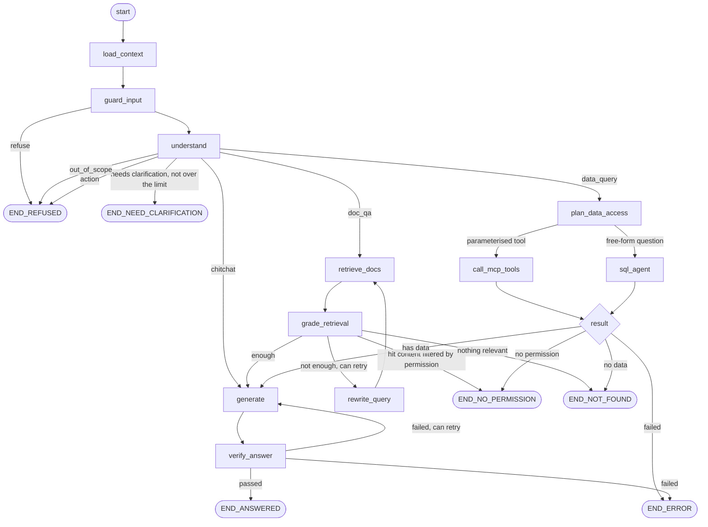

# Design document 04: agent flow (LangGraph), End states and reason codes

[中文](04-agent-flow.chn.md)

Status: **Approved by the user (2026-11-02); all 8 confirmation points of section 11 were accepted.** No application code is written before the other design documents are approved.
Depends on: 01, 02, 03. Marking convention: **[Decided]**, **[Proposed]**, **[Open]**.

## 1. Design principles

1. **The outer layer is a fixed graph**: search, permission filtering, verification and wrap-up are fixed nodes, and the LLM judges or generates in only a few named nodes (the conclusion of the RAGFlow trial).
2. **Identity comes only from the JWT** and is read-only once in the graph state. The LLM neither judges nor asks for the user's identity or role; a clarifying question is only about information the question itself lacks.
3. **Every path ends at an explicit End node** with a reason code [Decided].
4. **The conversation state is an explicit field of the graph state** (`session_mode`) and does not rely on implicit variables such as `sys.query` [Decided].
5. Every loop has a limit, and exceeding it ends with `error`, so nothing runs forever.

## 2. Graph state

| Field | Description |
|---|---|
| `identity` | From the JWT: `user_id`, `roles`, `campus_id`, `level`; **read-only** |
| `conversation_id`, `run_id` | |
| `messages` | The last few turns (**[Proposed]** 6 turns), with a rolling summary for older content |
| `session_mode` | `answering` / `need_clarification` |
| `pending_question` | While clarifying, keeps the user's original question |
| `clarify_count` | Consecutive clarifications |
| `intent` | `doc_qa` / `data_query` / `action` / `chitchat` / `out_of_scope` |
| `standalone_query` | The standalone question after rewriting with the history |
| `retrieved` | Search results (chunks, status, version, score) |
| `data_result` | The result of MCP or SQL |
| `budget` | LLM calls used, search retries, SQL retries, start time |
| `answer`, `citations` | |
| `end_state`, `end_reason` | |

The conversation-level state (`session_mode`, `pending_question`, `clarify_count`) is kept in three columns of `ai.conversations` (migration 0005) and the LangGraph Postgres checkpointer is not used [M5 revision, 2026-11-03]: in phase 1 every run is one complete, uninterrupted run ("needs clarification" also ends with an End, and the next turn comes in with the addition), so a checkpointer would not be used yet would add a set of tables, an initialisation and a version coupling. It is enabled in phase 2 when "write action confirmation" (`interrupt`) is built.

## 3. The graph

An exception or timeout in any node goes to `END_ERROR`.

## 4. The nodes

| Node | Type | What it does |
|---|---|---|
| `load_context` | code | Reads the history and the conversation state; if `session_mode = need_clarification`, treats this turn's input as an addition to `pending_question` |
| `guard_input` | code | Length limit, obvious prompt-injection signs, empty input; on a hit, `refused / input_blocked` |
| `understand` | LLM (structured output) | Outputs `intent`, `standalone_query`, `needs_clarification` with the clarifying question, and extracted codes. **Outputs no identity or permission** |
| `retrieve_docs` | code | Calls the `core` search: permission filter → full text + vector → RRF → rerank; also returns the number filtered out and the probe result (see 5.1) |
| `grade_retrieval` | code + threshold | Judges whether the hits are enough to answer; if not, allows **one** rewrite retry |
| `rewrite_query` | LLM | Rephrases or adds keywords and searches again |
| `plan_data_access` | LLM (structured output) | Prefers an MCP parameterised tool; only goes to the SQL agent when no tool fits |
| `call_mcp_tools` | code | Calls the tools defined in 03, forwarding the user's JWT, at most 3 calls |
| `sql_agent` | subgraph | Generate SQL → syntax and allow-list check → run as `ai_sql_ro` → at most 2 retries on failure |
| `generate` | LLM | Generates an answer with numbered citations from the supplied context only; rules in section 6 |
| `verify_answer` | code (phase 1) | Every citation number exists and matches this run's search results; the answer is not empty; over-long answers are cut. An LLM fact check is an option, see the confirmation points of section 11 |

## 5. End states and reason codes [Decided, values to be confirmed]

| `end_state` | `end_reason` | Triggered when | The user sees |
|---|---|---|---|
| `answered` | empty | Generated normally and passed verification | An answer with citations |
| `need_clarification` | `ambiguous_question` | The question is vague and cannot be searched | A clarifying question about the question |
| | `missing_parameter` | A required parameter is missing (such as student id or campus) | What is missing |
| `no_permission` | `restricted_document` | No result after filtering, but the probe finds highly relevant filtered content | The fixed refusal text |
| | `restricted_data` | MCP or SQL returned no permission | Same |
| `not_found` | `no_relevant_documents` | Not enough relevant content after filtering, and the probe found none either | The fixed "not found" text |
| | `no_matching_rows` | The data query returned nothing | Same |
| | `clarification_limit` | Two consecutive clarifications still cannot locate it | Asks the user to rephrase or contact support |
| `refused` | `out_of_scope` | Unrelated to enterprise knowledge and data | Says what the assistant can do |
| | `input_blocked` | The input was caught by a guard rule | A generic refusal |
| | `write_not_enabled` | A write action was requested (opened only in phase 2, and with confirmation) | Says it is not supported yet |
| `error` | `timeout` | More than 60 seconds | A generic error and the `request_id` |
| | `llm_error`, `retrieval_error`, `sql_failed`, `tool_error` | The matching component failed | Same |
| | `step_limit` | Over the step or call budget | Same |
| | `internal` | An unclassified exception | Same |

### 5.1 Telling `no_permission` and `not_found` apart

- The distinction is **for audit and statistics only**. When `retrieve_docs` has no result after the permission filter, it makes one more probe "without the permission filter, returning only the count and the highest score"; **the probe result does not go into the prompt and is not returned to the front end**.
- The user-facing text: **both cases use the same wording**, for example "Based on the documents available to your account, I could not find relevant information." This way a difference in the answer cannot leak that "a restricted document exists". The "must refuse" questions of the evaluation set pass with this text. [To be confirmed]

### 5.2 Guaranteeing that "every path has an End"

- Every End node calls the same `finish_run(end_state, end_reason)`: it writes `ai.runs`, `ai.messages` and `ai.audit_log` and tags the trace.
- Once the graph is built, an automated test walks every edge and **asserts that every node can reach some End node**, so there are no dead ends.
- The flow chart (the mermaid above) is exported from the graph definition automatically, so the chart in the document and the code stay consistent and are not maintained by hand.

## 6. Generation rules (what the prompt requires)

Written to `core/prompts/generate.md`; the prompt version is recorded in the trace:

1. Use only the supplied context; if the context has no answer, say honestly that nothing was found and do not make anything up.
2. Mark every fact with a citation number `[n]`.
3. With several versions: prefer `active` and say the old version has been superseded; when asked about the old policy, give both the old version's content and the version that applies now.
4. Quote exact values, codes and names without rewording.
5. **For calculations involving ranges, tiers or conditions, first say which range the input falls in, then apply the matching rule** (aimed at the late-penalty miscalculation seen in the RAGFlow trial).
6. The answer language follows the question.
7. Reveal nothing outside the context, and do not describe "what content you may not see".

## 7. Limits and timeouts [Proposed]

| Item | Limit |
|---|---|
| Total time of one run | 60 seconds (consistent with 03) |
| Graph steps (`recursion_limit`) | 20 |
| LLM calls in one run | 6 |
| Search rewrite retries | 1 |
| SQL retries | 2 |
| MCP tool calls | 3 |
| Consecutive clarifications | 2 |
| `generate` retries after a failed verification | 1 |

## 8. Models and observability

- **Each LLM node has its own model setting** (an environment variable), and no model name is hard-coded. Suggested: `understand`, `rewrite_query` and `plan_data_access` use a smaller, cheaper model, and `generate` a stronger one. The specific models are chosen in the implementation plan [Open].
- Each node is a span; trace tags include `end_state`, `end_reason`, prompt version, `filtered_count` and search mode.
- During an evaluation run the results are written to Langfuse scores (full profile).

## 9. Reserved for phase 2

| Feature | Place in the graph |
|---|---|
| Streaming output | The `generate` node streams; the event format is in 03 |
| Write action confirmation | The `action` intent → `confirm_action` (LangGraph `interrupt`, waiting for the user's confirmation) → execute; in phase 1 that intent goes straight to `refused / write_not_enabled` |
| Memory | `load_memory` (after `load_context`) and `save_memory` (before End); stores only stable user preferences and facts, never restricted document content |
| Cost statistics | Summed from `ai.runs` |

## 10. How it is tested

1. **Graph structure tests**: every node can reach an End; no unhandled branch.
2. **Scenario tests** (with a fake LLM and search stubs): at least one case for every End state, including `clarification_limit` after two clarifications, the retry limits and the timeout.
3. **Evaluation set**: 54 document questions + 16 SQL questions, each run once for every role and campus account, counting accuracy and permission regression; the `access` questions must all pass.

## 11. Points for you to confirm

1. A new End state `refused` (out of scope, input blocked, a write request in phase 1): accepted?
2. 5.1: `no_permission` and `not_found` are **told apart internally and use the same text for the user**: accepted?
3. `understand` does not judge identity, and clarification is only about the question itself: accepted?
4. `data_query` prefers the MCP parameterised tools and only goes to the SQL agent when no tool fits: accepted?
5. In phase 1 `verify_answer` only does deterministic checks (citation numbers match, not empty), and the LLM fact check is decided after the evaluation: accepted?
6. The limits of section 7 (especially 2 consecutive clarifications, 1 search rewrite retry): accepted?
7. Anything to add or remove in the generation rules of section 6 (especially items 3 and 5)?
8. Each LLM node has its own model setting, with the specific models chosen in the implementation plan: accepted?

## 12. Confirmation results (2026-11-02)

All 8 points were accepted: the new `refused` state; `no_permission` and `not_found` told apart internally with the same text for the user; `understand` not judging identity; data queries preferring MCP parameterised tools; `verify_answer` doing deterministic checks only in phase 1; the limits; the generation rules; a separate model setting for each LLM node.

## 13. M5 revision record (2026-11-03)

- The conversation state is stored in `ai.conversations` and no checkpointer is used (see section 2).
- `finish_run` is called by the runtime wrapper rather than by each End node: End nodes only set the final state, so exceptions and timeouts are always recorded. The graph structure test "every node can reach some End node" is unchanged.
- Data queries (`data_query`) end with `refused / not_available_yet` before M6 (a temporary reason code, removed in M6, see section 14).
- The history is only cut to the last 6 turns, with no rolling summary yet.
- `chitchat` (greetings) uses a fixed reply and does not call the model.
- `grade_retrieval` has two gates: a rerank score threshold (configurable) and the `sufficient` flag of the generate node.
- **Rerank truncation**: in the rerank prompt the limit per passage (`rerank_passage_tokens`) must be no smaller than the chunk limit (500). Cutting shorter stops the model from seeing the end of the chunk, it gives a very low score, and the first gate then refuses to answer (the `ERR-PORTAL-429` case is in `docs/eval/README.md`). The default is 600.
- **The `restricted` decision**: the hidden-content probe must score ≥ 0.5 to count as "restricted content exists" (in the sample, restricted questions score 0.57 to 0.74 and unanswerable ones 0.09 to 0.41, a narrow gap).
- **The prompt of the understand step** lists the topics of tech support, so that "a tool is not working" is not treated as out of scope (prompt version 2).

## 14. M6 revision record (2026-11-03): the data query path

After `understand` decides `data_query`, the new nodes are:

1. `plan_data_access`: one model call (`model_plan`) that chooses "tool" or "SQL". The 5 selectable tools: `list_assignments`, `list_students`, `get_student_progress`, `get_expense_claim_status`, `list_my_expense_claims`. If the output is unusable it goes to SQL.
2. `call_data_tool`: calls the tool (in production over HTTP, forwarding the user's own token; an in-process implementation is used for tests and evaluation). `forbidden` → `no_permission / restricted_data`; `not_found` → `not_found / no_matching_rows`; `invalid_argument` → fall back to SQL; anything else → `error / tool_error`.
3. `run_sql`: first retrieves 3 policy passages (hybrid mode, no rerank, permission filter as usual), and hands them with the schema description to `model_sql` to write one SELECT; `sqlglot` validates it (a single statement, an allow-list of read-only views, an allow-list of functions; what is run is the statement the parser regenerates); two checks **before execution**: whether the role may access the view at all, and whether the campus written by a role without company-wide scope is its own → if either fails, `no_permission / restricted_data`; otherwise it runs as `ai_sql_ro`. If the statement is rejected or the database reports an error it retries with the reason, at most 2 times, and if it still fails → `error / sql_failed`. No result → `not_found / no_matching_rows`.
4. `answer_from_data`: one model call that answers only from the returned rows (at most `data_rows_to_model` rows), with citations of `kind: "data"`; the answer must contain `[1]` (added if missing).

The text the user sees: `restricted_data` and `no_matching_rows` use the same sentence ("no matching records were found in the data visible to your account"), so it does not reveal whether the data exists. Prompt versions: `plan_data` 1, `sql` 1, `answer_data` 1. The model call limit of one run is 8.
