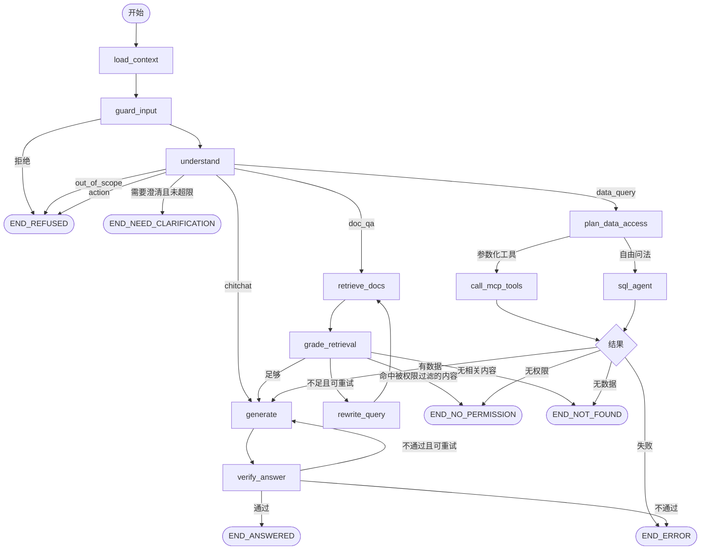

# 设计文档 04：Agent 流程（LangGraph）、End 状态与原因码

状态：**已获用户批准（2026-11-02），第 11 节 8 个确认点全部接受。** 其余设计文档批准前不写应用代码。
依赖：01、02、03。标记约定：**【已定】**、**【建议】**、**【待定】**。

## 1. 设计原则

1. **外层是固定的图**：检索、权限过滤、校验、收尾都是固定节点，LLM 只在几个明确的节点里做判断或生成（RAGFlow 试用的结论）。
2. **身份只来自 JWT**，进入图状态后只读。LLM 不判断、不询问用户的身份或角色；反问只针对"问题本身"缺少的信息。
3. **每条路径都以显式 End 节点结束**，并带原因码【已定】。
4. **会话状态是图状态里的显式字段**（`session_mode`），不依赖 `sys.query` 之类的隐式变量【已定】。
5. 所有循环都有上限，超限就以 `error` 结束，不会无限运行。

## 2. 图状态

| 字段 | 说明 |
|---|---|
| `identity` | 来自 JWT：`user_id`、`roles`、`campus_id`、`level`；**只读** |
| `conversation_id`、`run_id` | |
| `messages` | 最近若干轮（**【建议】** 6 轮），更早的内容用滚动摘要 |
| `session_mode` | `answering` / `need_clarification` |
| `pending_question` | 处于澄清中时，保存用户的原始问题 |
| `clarify_count` | 连续澄清次数 |
| `intent` | `doc_qa` / `data_query` / `action` / `chitchat` / `out_of_scope` |
| `standalone_query` | 结合历史改写后的独立问题 |
| `retrieved` | 检索结果（分块、状态、版本、分数） |
| `data_result` | MCP 或 SQL 的结果 |
| `budget` | 已用 LLM 调用数、检索重试数、SQL 重试数、开始时间 |
| `answer`、`citations` | |
| `end_state`、`end_reason` | |

会话级的状态（`session_mode`、`pending_question`、`clarify_count`）保存在 `ai.conversations` 的三列里（迁移 0005），不使用 LangGraph 的 Postgres checkpointer【M5 修订，2026-11-03】：第一阶段每次运行都是一次完整、没有中断的运行（"需要澄清"也是以 End 结束，下一轮再带着补充进来），checkpointer 用不上，却要多一套表、一次初始化和版本耦合。第二阶段做"写操作确认"（`interrupt`）时再启用它。

## 3. 图

任何节点抛出异常或超时，统一进入 `END_ERROR`。

## 4. 节点说明

| 节点 | 类型 | 作用 |
|---|---|---|
| `load_context` | 代码 | 读取历史、会话状态；若 `session_mode = need_clarification`，把本轮输入作为对 `pending_question` 的补充 |
| `guard_input` | 代码 | 长度上限、明显的提示词注入特征、空输入；命中则 `refused / input_blocked` |
| `understand` | LLM（结构化输出） | 输出 `intent`、`standalone_query`、`needs_clarification` 及反问内容、抽取的编号。**不输出身份或权限** |
| `retrieve_docs` | 代码 | 调用 `core` 检索：权限过滤 → 全文 + 向量 → RRF → Rerank；同时返回被过滤的数量和探测结果（见 5.1） |
| `grade_retrieval` | 代码 + 阈值 | 判断命中是否足够回答；不足时允许**一次**改写重试 |
| `rewrite_query` | LLM | 换一种说法或补充关键词，重新检索 |
| `plan_data_access` | LLM（结构化输出） | 优先选择 MCP 参数化工具；没有合适工具时才走 SQL Agent |
| `call_mcp_tools` | 代码 | 调用 03 里定义的工具，转发用户 JWT，最多 3 次调用 |
| `sql_agent` | 子图 | 生成 SQL → 语法与白名单校验 → 用 `ai_sql_ro` 执行 → 失败最多重试 2 次 |
| `generate` | LLM | 只基于提供的上下文生成带编号引用的回答，规则见 6 |
| `verify_answer` | 代码（第一阶段） | 引用编号都存在且对应本轮检索结果；回答非空；超长截断。LLM 事实核查作为选项，见 8 的确认点 |

## 5. End 状态与原因码【已定，取值待确认】

| `end_state` | `end_reason` | 触发条件 | 用户看到 |
|---|---|---|---|
| `answered` | 空 | 正常生成并通过校验 | 带引用的回答 |
| `need_clarification` | `ambiguous_question` | 问题含糊，无法检索 | 针对问题的反问 |
| | `missing_parameter` | 缺少必要参数（如学员编号、校区） | 说明缺什么 |
| `no_permission` | `restricted_document` | 过滤后无结果，但探测发现存在被过滤的高相关内容 | 固定的拒绝文案 |
| | `restricted_data` | MCP 或 SQL 返回无权限 | 同上 |
| `not_found` | `no_relevant_documents` | 过滤后无足够相关内容，探测也没发现 | 固定的"没有找到"文案 |
| | `no_matching_rows` | 数据查询无结果 | 同上 |
| | `clarification_limit` | 连续澄清 2 次仍无法定位 | 请用户换一种问法或联系支持 |
| `refused` | `out_of_scope` | 与企业知识和数据无关 | 说明助手能做什么 |
| | `input_blocked` | 输入被防护规则拦截 | 通用拒绝 |
| | `write_not_enabled` | 请求写操作（第二阶段才开放，且需确认） | 说明暂不支持 |
| `error` | `timeout` | 超过 60 秒 | 通用错误和 `request_id` |
| | `llm_error`、`retrieval_error`、`sql_failed`、`tool_error` | 对应组件失败 | 同上 |
| | `step_limit` | 超过步数或调用预算 | 同上 |
| | `internal` | 未分类异常 | 同上 |

### 5.1 `no_permission` 与 `not_found` 的区分

- 区分只用于**审计和统计**。`retrieve_docs` 在权限过滤后无结果时，再做一次"不带权限过滤、只返回数量和最高分"的探测；**探测结果不进入提示词，也不返回前端**。
- 面向用户的文案：**两种情况使用相同措辞**，例如"根据你当前账号可访问的资料，我没有找到相关信息。"这样不会通过回答差异泄露"受限文档存在"。评测集里"必须拒绝"的题目用这条文案通过。【待确认】

### 5.2 保证"每条路径都有 End"

- 所有 End 节点都调用同一个 `finish_run(end_state, end_reason)`：写 `ai.runs`、`ai.messages`、`ai.audit_log`，并在 trace 上打标签。
- 图构建完成后，用自动化测试遍历所有边，**断言每个节点都能到达某个 End 节点**，没有"断头路"。
- 流程图（上面的 mermaid）由图定义自动导出，文档里的图和代码保持一致，不手工维护。

## 6. 生成规则（提示词的要求）

写入 `core/prompts/generate.md`，提示词版本号记录在 trace 里：

1. 只使用提供的上下文；上下文没有答案就如实说没有找到，不编造。
2. 每个事实后标注引用编号 `[n]`。
3. 有多个版本时：优先使用 `active`，说明旧版本已被取代；被问到旧政策时，同时给出旧版本内容和当前适用版本。
4. 引用精确数值、编号、名称，不改写。
5. **涉及区间、阶梯、条件的计算，先说明输入落在哪个区间，再应用对应规则**（针对 RAGFlow 试用中迟交扣分算错的问题）。
6. 回答语言与问题一致。
7. 不透露上下文以外的信息，也不描述"有哪些内容你无权查看"。

## 7. 限额与超时【建议】

| 项 | 上限 |
|---|---|
| 一次运行总时长 | 60 秒（与 03 一致） |
| 图步数（`recursion_limit`） | 20 |
| 一次运行的 LLM 调用数 | 6 |
| 检索改写重试 | 1 |
| SQL 重试 | 2 |
| MCP 工具调用 | 3 |
| 连续澄清 | 2 |
| `generate` 校验失败重试 | 1 |

## 8. 模型与可观测性

- **每个 LLM 节点单独配置模型**（环境变量），代码里不写死模型名。建议：`understand`、`rewrite_query`、`plan_data_access` 用较小较便宜的模型，`generate` 用更强的模型。具体模型在实施计划里选定【待定】。
- 每个节点是一个 span；trace 标签包括 `end_state`、`end_reason`、提示词版本、`filtered_count`、检索方式。
- 评测运行时，评测结果写入 Langfuse 的 score（full profile）。

## 9. 第二阶段预留

| 功能 | 在图中的位置 |
|---|---|
| 流式输出 | `generate` 节点流式产出，事件格式见 03 |
| 写操作确认 | `action` 意图 → `confirm_action`（LangGraph `interrupt`，等待用户确认）→ 执行；第一阶段该意图直接 `refused / write_not_enabled` |
| Memory | `load_memory`（`load_context` 之后）与 `save_memory`（End 之前）；只存稳定的用户偏好和事实，不存受限文档内容 |
| 成本统计 | 从 `ai.runs` 汇总 |

## 10. 测试方式

1. **图结构测试**：每个节点可达 End；没有未处理的分支。
2. **场景测试**（用假的 LLM 和检索桩）：每个 End 状态各至少一个用例，包括澄清两次后的 `clarification_limit`、重试上限、超时。
3. **评测集**：54 条文档问答 + 16 条 SQL 问答，每个角色和校区账号各跑一遍，统计准确率和权限回归；`access` 类题目必须全部通过。

## 11. 需要你确认的点

1. 新增 End 状态 `refused`（越界、输入被拦截、第一阶段的写操作请求），是否接受？
2. 5.1：`no_permission` 与 `not_found` **内部区分、对用户使用相同文案**，是否接受？
3. `understand` 不判断身份，澄清只针对问题本身，是否接受？
4. `data_query` 优先用 MCP 参数化工具，没有合适工具才走 SQL Agent，是否接受？
5. 第一阶段 `verify_answer` 只做确定性检查（引用编号对应、非空），LLM 事实核查放到后面评测后再决定，是否接受？
6. 第 7 节的各项上限（尤其连续澄清 2 次、检索改写重试 1 次），是否接受？
7. 第 6 节生成规则（尤其第 3、5 条）是否有要增删的？
8. 每个 LLM 节点单独配置模型、具体模型到实施计划再选，是否接受？

## 12. 确认结果（2026-11-02）

8 个确认点全部接受：新增 `refused` 状态；`no_permission` 与 `not_found` 内部区分、对用户同文案；`understand` 不判断身份；数据查询优先 MCP 参数化工具；第一阶段 `verify_answer` 只做确定性检查；各项上限；生成规则；每个 LLM 节点单独配置模型。

## 13. M5 修订记录（2026-11-03）

- 会话状态存在 `ai.conversations`，不用 checkpointer（见第 2 节）。
- `finish_run` 由运行时包装层调用，而不是由每个 End 节点调用：End 节点只设置最终状态，这样异常和超时也一定会被记录。"每个节点都能到达某个 End 节点"的图结构测试不变。
- 数据查询（`data_query`）在 M6 之前以 `refused / not_available_yet` 结束（临时原因码，M6 实现后移除）。
- 历史只截断最近 6 轮，暂不做滚动摘要。
- `chitchat`（问候）用固定回复，不调用模型。
- `grade_retrieval` 分两道关：重排分数阈值（可配置）和生成节点的 `sufficient` 标志。
- **重排的截断**：重排提示词里每个片段的上限（`rerank_passage_tokens`）必须不小于块的上限（500）。截得更短会让模型看不到块尾的内容，给出很低的分数，第一道关就会拒绝作答（`ERR-PORTAL-429` 的实例见 `docs/eval/README.md`）。默认 600。
- **`restricted` 的判定**：隐藏内容的探测得分 ≥ 0.5 才算"存在受限内容"（样例里受限问题得分 0.57–0.74，无答案问题 0.09–0.41，间隔很窄）。
- **理解步骤的提示词**列出了技术支持的主题，避免把"工具出问题"当作越界（提示词版本 2）。
